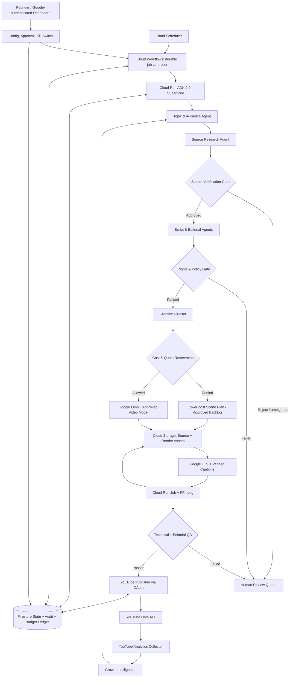

# HIDAYAH AI — Google-Native Autonomous Islamic YouTube Studio

**Founder, Product, Editorial, Technical Architecture, Engineering & Execution Master Blueprint | Version 2.0 | 22 November 2026**

> **Mandate:** Build a Google-native, agent-operated Islamic YouTube channel that produces and publishes one excellent, accurately sourced, original YouTube Short each day. Use Claude Code only to design, implement, evaluate, deploy, and maintain the codebase; run production on Google Cloud with Google ADK and Gemini. Never trade religious accuracy or channel safety for automation.

## 1. Executive decision

- **Channel:** Hidayah, a source-grounded Islamic reminders and educational Shorts channel.
- **Initial format:** One 9:16 YouTube Short per day, approximately 15 seconds, for a 30-day controlled pilot.
- **Initial generation model:** Google's `gemini-omni-1.2-flash` for short video backgrounds/scenes, subject to project access, current rate card, geographic availability, and test results. Prefer 720p drafts; upscale selectively after QA.
- **Infrastructure and orchestration:** Google Cloud Scheduler, Google Cloud Workflows, Cloud Tasks as appropriate, Cloud Run, Firestore, Cloud Storage, Cloud Logging/Monitoring, IAM, and Secret Manager.
- **Agent framework:** Google Agent Development Kit (ADK), with current graph-based `Workflow` patterns and specialized `LlmAgent`/custom agents. Avoid deprecated Python/TypeScript `SequentialAgent`, `ParallelAgent`, and `LoopAgent` in newly written code.
- **Reasoning:** Gemini Flash-class models by default, stronger Gemini model selectively for difficult editorial or research checks.
- **Narration and captions:** Google Cloud Text-to-Speech or supported Gemini TTS (after testing), while exact Quranic/Arabic source text is rendered deterministically in a postproduction layer—never entrusted to a generated-video model.
- **Media renderer:** FFmpeg running *inside Google Cloud Run Jobs*; a local/open-source processing library does not violate the Google-only hosted-services policy.
- **Publishing:** YouTube Data API v3 and YouTube Analytics API, authorized through owner-granted OAuth 2.0 permissions.
- **Founder control:** Minimal Google-hosted dashboard with production queue, factual-source review, budget, publication calendar, incident reports, and kill switch.
- **Initial budget target:** US$50/month *planning ceiling*, not a promise that all services will fit. At $0.07 per generated second, 30 successful 15-second 720p generations total ~$31.50 in video-generation cost alone; retries and all other services add cost.
- **Operating rule:** Fully automated execution; publication of *pre-verified, policy-compliant content only*. Unresolved religious claims or publisher-policy issues move to human review, never silent approval.

## 2. Investigation first: no spending, deployment, or production changes

Claude Code must inventory the already-connected Google Cloud project, available Google ADK/Agent Platform features, current Gemini API paid tier, Google AI Pro subscription, Google Flow, Google Vids, Veo variants, Omni 1.2 Flash, Google Imagen/image generation, Gemini/Cloud TTS, and YouTube APIs.

Research must distinguish (a) app subscription capabilities, (b) Gemini Developer API billing and quotas, and (c) Google Cloud/Agent Platform or Vertex model access. Do not assume the user's Google AI Pro subscription grants paid API credits. For each option report official API availability, exact model identifier, capabilities, video length, 9:16 support, audio, quality, resolution, region, access requirements, quotas, pricing, content licensing, privacy, and production readiness. Include dated official documentation links, evidence and confidence.

Audit *read-only*: accessible Google Cloud project IDs/names, regions, enabled APIs, service account permissions, billing status (not sensitive payment details), credits, quotas, budgets, Google Cloud/AI Studio pricing, and YouTube OAuth readiness. Explicitly note what cannot be verified using the current logged-in CLI/account and which owner checks are required. Never print tokens, secret values, private keys, or channel refresh tokens.

Required outputs before implementation:
1. `docs/research/google-ecosystem-audit.md` — verified matrix with sources and alternatives.
2. `docs/research/access-and-billing-report.md` — redacted service status, model eligibility, quotas, monthly cost scenarios, risks.
3. `docs/architecture/architecture-decision-records.md` — architecture with alternatives/reasons.
4. `docs/plan/implementation-backlog.md` — ordered tasks, estimates, dependencies, test acceptance criteria.
5. `docs/risks/compliance-and-editorial-risk-register.md` — source accuracy, copyright, generated-media disclosure, YouTube spam/inauthentic-content restrictions, OAuth, cost overruns.

**Approval gate:** Do not enable APIs, initiate paid generation, increase permissions, deploy public services, or upload to YouTube until the founder approves the research findings and specific costs/actions.

## 3. Content strategy and editorial charter

**Editorial promise:** One meaningful, concise, authentic Islamic reminder every day, clearly sourced and respectfully presented. Build trust and returning viewership rather than maximize upload count.

**Pilot content pillars:**
- Quranic reflections: short, directly supported explanations, not fabricated interpretations.
- Daily du'a and dhikr: exact authentic wording, context and references; no false reward claims.
- Verified hadith: collection, source locator, grade, and context recorded.
- Character and manners: gratitude, patience, honesty, kindness, forgiveness.
- Islamic history: limited to sources reviewed for historical reliability.

**Ethical production rules:**
- No portrayals of prophets or revered figures; use scenery, mosques, calligraphy, maps, architecture, original motion design, or abstract backgrounds.
- No made-up Arabic text, Quran verses, hadith, reward/punishment claims, historical quotes, or scholarly consensus.
- Never let Gemini invent verse or hadith references: quote from an approved, versioned source registry, then run programmatic exact-text checks.
- Distinguish sourced scripture, narrator's explanation, and visual metaphor.
- Exclude sectarian attacks, fearmongering, miracles presented as guaranteed, or manipulative clickbait.
- Arabic pronunciation and textual rendering must be verified; do not use generative video text or unverified text-to-speech for canonical quotations.
- Confirm commercial licenses for translations, audio, fonts, stock imagery, nasheeds/music, and any sourced assets. Record licensing in asset metadata.
- Disclose realistic synthetic material when required by YouTube and apply `status.containsSyntheticMedia` if appropriate.
- Reject duplicative, low-effort, mass-produced templates that risk YouTube's inauthentic/repetitive-content policies.

**Language setting:** Keep the launch language configurable; the founder must choose rather than having engineering infer a language. Multilingual voice/captions can be a later workflow using verified translation and pronunciation checks.

**15-second content formula:** 0–2s curiosity or heart-centered hook; 2–11s one authentic message; 11–15s takeaway with exact reference on-screen and/or in description. Narration generally needs to be concise (approximately 20–30 words, adjusted for TTS pace and Arabic).

**Pilot publishing target:** One Short/day. A/B tests should change one creative variable at a time; analyze 24/48-hour and 7-day views where data is mature enough. Keep at least 7 approved, ready-to-publish Shorts in queue.

## 4. Target architecture

```text
Founder / Hidayah Control Center (Firebase Hosting + Firebase Auth)
     |
Google Cloud Scheduler (daily trigger)
     |
Google Cloud Workflows (durable business process, backoff, compensation)
     |
ADK Coordinator on Cloud Run (Gemini; strict tool permissions)
     |
     +-- Audience Strategy / Topic Discovery
     +-- Source Research -> Religious Verification (mandatory pass)
     +-- Scriptwriter -> Editorial Compliance
     +-- Creative Director -> Video Production Planner
     +-- Omni/Veo media generation (cost gate first)
     +-- TTS + Audio + Deterministic captions (Cloud Run renderer)
     +-- Technical + Editorial QA (mandatory pass)
     +-- YouTube Publisher (OAuth user authorization)
     +-- Analytics -> Learning / Content Plan updates
     +-- Finance and Operations / Incident Monitor
     |
Firestore (production state, dedupe, source ledger, metadata, metrics)
Cloud Storage (raw assets, renders, proofs, manifests)
Secret Manager + IAM (credentials and scoped permissions)
Cloud Logging, Monitoring, Error Reporting, alerting
```

Use ADK for structured agent decisions, not for irreversible operations. External service calls (video generation, publishing, payments) go through typed, audited, idempotent service adapters invoked by the workflow. Distinguish orchestration at two layers: ADK `Workflow` handles agent reasoning graphs; Cloud Workflows persists end-to-end business execution and resumes after failures.

### Agent roster and tool access

| Agent | Inputs | Outputs | Permissions and gates |
|---|---|---|---|
| Channel Manager | calendar, queue, policy, cost | daily brief and assignments | read statuses; cannot publish |
| Audience Strategist | approved themes, channel analytics | ranked topics, novelty evidence | search/analytics read only |
| Islamic Researcher | selected topic, source registry | canonical references and context | approved registry read only |
| Islamic Verification | research package | `approved/needs_review/rejected`, reasons | hard gate, source matching; cannot hallucinate verification |
| Scriptwriter | approved sources, duration | timed script, on-screen text, descriptions | must attach canonical source IDs |
| Editorial Compliance | script, channel policy | release safety decision | can block; cannot override source gate |
| Creative Director | approved script, style guide | detailed scene prompt, shot list | cannot alter canonical quotations |
| Video Producer | approved scene plan, remaining budget | model request, video asset manifest | only cost-gated video API calls |
| Voice and Captions | approved narration, pronunciation rules | audio, cue sheet, subtitle timings | no unauthorized recitation imitation |
| Quality Assurance | full render, script, evidence | checks, scores, failure reasons | required pass before upload |
| Publishing Manager | QA-approved release manifest | YouTube video ID, processing/publish status | narrowly scoped OAuth, idempotency |
| Growth Intelligence | YouTube Analytics & content history | weekly insights, hypotheses | analytics read only; no vanity-metric optimization |
| Finance and Operations | usage, budget, failures | spend status, alerts, incident tickets | can pause spend; cannot raise limits |

A 12-specialist conceptual roster may be consolidated into fewer deployed agents early. The critical objective is separation of responsibilities and approval gates, not maximizing the number of paid model calls.

## 5. Durable state machine and data model

**States:** `IDEA` → `TOPIC_SELECTED` → `SOURCE_VERIFIED` → `SCRIPT_APPROVED` → `SCENES_PLANNED` → `MEDIA_GENERATED` → `RENDERED` → `QA_PASSED` → `UPLOAD_PENDING` → `UPLOADED` → `PUBLISHED` → `ANALYZED`; side states: `RETRY_PENDING`, `HUMAN_REVIEW`, `FAILED`, `CANCELLED`.

**Firestore collections:**
- `channel_config`: language, publishing window, allowed topics, budgets, emergency stop, model policy.
- `source_registry`: `source_id`, type, canonical Arabic text, translation ID/version, locator, collection/grading, license, reviewer/version, approval status.
- `ideas`: topic, source references, novelty hash, content pillar, editorial priority.
- `content_jobs`: `job_id`, `channel_id`, publication date, workflow state, stage attempts, immutable versioned specs, source IDs.
- `media_assets`: asset URIs, SHA-256 hash, duration, resolution, model ID, estimated/actual cost, licensing, provenance.
- `publications`: job ID, channel ID, planned publish timestamp, idempotency key, YouTube video ID, processing state, URL.
- `analytics_daily`: impressions, engaged views, retention, average percentage viewed, shares, subscriber deltas, costs and collection date.
- `audit_events`: actor, action, stage, result, time, redacted justification and correlation ID.
- `budget_ledger`: reserved estimates, confirmed usage, daily/monthly ceilings, retry and failure charges.

Deduplicate on `(channel_id, publication_date, content_version)` and persist the YouTube video ID immediately after upload. A resumed task must reconcile platform status instead of uploading a duplicate. Use transactions or preconditions for stage transitions; immutable release manifests prevent post-QA script changes.

## 6. Daily execution and failure policy

1. `T-48h`: plan topics from approved editorial calendar; reject near duplicates.
2. Research and verify the exact reference; store citation, source version and license.
3. Write a short script and create an asset manifest. Validate exact source correspondence.
4. Cost gate: reserve estimated 15-second generation cost and account for retries/other services.
5. Generate 9:16 non-text scenery or appropriate visual; no Arabic, verse references, captions, or spoken quotations baked into generated video.
6. Generate/approve narration; add precise licensed Arabic/English text and subtitle timings with deterministic renderer.
7. Run technical tests (dimensions, frames, codec, loudness, subtitle clipping, continuity, 15-second range) and semantic checks against source and narration.
8. Failed QA: one bounded regeneration if budget remains, then hold for review. No silent source substitution.
9. Upload as private; confirm processing completed, inspect metadata and flags, and schedule a public release only if configured approval gates pass.
10. Collect analytics asynchronously at suitable intervals; provide a daily digest and weekly learning report.

**Failure rules:** Exponential backoff for transient 429/5xx; never retry permanent validation errors; strict timeouts and per-stage rate limits; do not auto-resubmit upload when response is ambiguous before reconciling YouTube channel videos; pause if licensing, source checks, or spend guards fail. Alerts go to the founder; daily upload can be skipped rather than publish potentially false religious content.

## 7. API and credential security

- User-authorized OAuth 2.0 for YouTube channel uploads; never treat a cloud service account as equivalent to the channel owner.
- Store refresh tokens and any client secrets in Secret Manager, allow least-privilege read access only to the publisher service identity.
- Use Application Default Credentials and dedicated service accounts for Google Cloud workloads; no long-lived credential JSON in source control.
- Keep public dashboard behind Firebase Authentication and strong authorization. Publishing, policy and budget settings require privileged owner permissions.
- Separate development/staging/production projects or environments; default dry-run mode and private YouTube uploads in staging.
- Add audit trails for cost, source review, settings, and publishing actions without storing secret payloads or sensitive prompts unnecessarily.
- Limit access to video generation, upload, and IAM changes; do not grant agents broad admin or billing owner roles.
- Use Terraform or Google Cloud IaC and Cloud Build deployments with reviews, secrets scanning and dependency checks.

## 8. Budget and model-routing policy

**Base estimate:** 15 s × $0.07/s = ~$1.05 successful video-generation cost/day; 30 days ≈ $31.50. This is *not* total monthly spend and excludes failed attempts, TTS, Gemini tokens, renders, storage, traffic and taxes. Exact pricing and billing need audit before purchase.

- Pilot monthly planning ceiling: $50.
- Default daily budget: derived dynamically from remaining budget, planned days and reserve; no hard-coded unlimited retries.
- Stop new generations if forecast monthly spend would exceed the configured application budget.
- Reserve a retry buffer and track confirmed charges against estimates and actual billing.
- Use free or low-cost deterministic kinetic typography + permitted original images as a fallback, retaining meaningful variation and originality.
- Maintain separate guardrails for Google Cloud and Gemini Developer API billing if both are used.
- Investigate generally available Google Cloud spend-cap budgets (GA announced 30 October 2026) and confirm service-specific coverage; add regular budgets/alerts and application cost gate regardless.
- Prioritize low-cost script/research calls and approved references; route only exceptional ambiguity to a stronger Gemini model.

## 9. Founder dashboard (minimal MVP)

Visible controls: today's pipeline stage; next 7 scheduled releases; approved source references; rendered preview; generation expenses today/month; budget ceiling; upload/processing status; analytics over 7/28 days; blockers and retry count; human-review inbox; publish pause/resume; manual re-run with cost estimate; incident alerts. Dashboard actions are audited and protected by owner authentication.

## 10. Measurements and success criteria

**Product KPIs:** religious citation accuracy; zero approved hallucinated canonical quotations; successful scheduled publish ratio; duplicate-upload count; cost per shipped Short; production cycle time; manual review rate; mean time to recovery.

**Channel KPIs:** engaged Shorts views, completion/average percentage viewed, viewed-vs-swiped-away when available, shares, repeat viewers, subscribers per 1,000 engaged views, performance by topic and hook. Use current YouTube definitions and account for analytics lag; avoid treating raw view count as the same as eligible monetization views.

**Launch gates:**
- Read-only cloud/API audit approved by founder, with documented exact pricing/limits.
- At least 30 source-verification test cases, including falsified hadith references, out-of-context verse translations and Arabic-text errors; all unacceptable cases block publication.
- 3 end-to-end private upload rehearsals pass on real YouTube API, no public release.
- No duplicate uploads across retried/replayed schedules.
- Video, captions, narration and aspect ratio pass actual device-preview checks.
- Budget kill switch, credentials rotation and failure/incident notification tested.
- Publish only preapproved source categories during pilot, with explicit owner go-live approval.
- During 30-day pilot, assess quality and reliability before increasing volume or runtime expenses.

## 11. Implementation plan and deliverables

**Phase 0 — Research (1–2 days estimate):** read-only Google ecosystem, APIs, subscriptions, credits, permissions, quotas and source licensing audit. No paid calls or deployment. Produce findings and decision records. Founder approves plan.

**Phase 1 — Foundation (3–5 days estimate):** Python project, ADK graph workflow, schemas, source registry, typed tools, Firestore/Storage adapters, IaC, tests, monitoring, environment boundaries.

**Phase 2 — Content intelligence (3–5 days estimate):** topic, source researcher, religious verifier, script and compliance agents; source evidence and negative tests.

**Phase 3 — Production (3–5 days estimate):** Omni and fallback generator, Google TTS, deterministic text/captions renderer, FFmpeg, QA scoring, cost/usage ledger; three varied real Shorts.

**Phase 4 — YouTube launch (3–5 days estimate):** authorized OAuth, staging uploads, scheduler/Cloud Workflows, status reconciliation, YouTube Analytics, 7-day content buffer, dashboard.

**Phase 5 — Controlled autonomy (14–30 days):** dry-run, review-first publishing, gradually auto-release from approved source corpus, daily reports, weekly analytics, risk assessments and optimization.

**Phase 6 — Scale only with evidence:** move from 15s to 30–60s via multiple shots, multilingual verified captions/narration, more series, later long-form educational videos. Scale only if content quality, licensing, cost and channel engagement justify it.

Estimates are indicative, not guarantees. API access, verification and source-license research may change the build sequence.

## 12. Repository layout

```text
hidayah-ai/
  apps/control-center/             # Firebase-hosted founder dashboard
  services/agent-api/              # Python ADK agents, coordinator, typed tools
  services/media-renderer/         # Cloud Run Job + FFmpeg + subtitles
  services/youtube-publisher/      # OAuth, resumable upload, status reconciliation
  services/analytics-worker/       # YouTube Analytics collector
  packages/contracts/              # Pydantic contracts, state models
  packages/source-registry/        # canonical scripture, reference and license adapters
  packages/cost-controls/          # token/video estimation, spend reservations
  workflows/                       # durable Cloud Workflows YAML
  infrastructure/terraform/        # project/environment configuration
  tests/unit/
  tests/integration/
  tests/e2e/
  tests/editorial-evals/
  docs/research/
  docs/architecture/
  docs/policies/
  docs/runbooks/
  docs/plan/
  docs/risks/
  .github/workflows/              # CI (Cloud Build may be primary)
  README.md
  CLAUDE.md                        # nonnegotiable coding, privacy and release rules
```

## 13. Claude Code master instruction — paste directly

```text
You are the principal architect, staff Google Cloud engineer, Google ADK specialist, AI-video pipeline engineer, security engineer, religious-source accuracy lead, QA lead, FinOps engineer, and YouTube channel strategist for HIDAYAH AI.

MISSION
Develop a Google-native, autonomous Islamic YouTube Shorts studio. Claude Code is the software development interface, NOT the production inference engine. Use Google ADK + Gemini for specialist agents, Google Cloud for runtime/infrastructure, Google's official APIs for generation and YouTube publishing. Initial target: one authentic, source-verified, original, 9:16 Short approximately 15 seconds daily. Target planning ceiling: USD $50/month, subject to real cost audit. Respect licensing and YouTube policy.

CURRENT CONTEXT
My Google Cloud account/project, Google ADK setup, Google AI Pro plan, Gemini API paid tier, and related services have reportedly been connected to Claude Code. Do NOT assume this grants API quotas, free video generation, YouTube publish permission, or a specific service version. Verify everything using read-only inspection and official documentation, with secrets redacted.

STEP 0 — RESEARCH ONLY; DO NOT START BUILDING
Investigate all realistic Google products/official APIs for this workflow, at least: Google Flow, Google Vids, Gemini Omni 1.2 Flash, Veo variants, image generation models, Gemini/Cloud TTS, Gemini text and grounding, Google ADK current APIs, Agent Platform vs Cloud Run, Cloud Scheduler, Workflows, Tasks, Firestore, Storage, Secret Manager, OAuth, YouTube Data and Analytics APIs, Cloud Billing budgets/spend caps, model quotas and release changes. Determine what has an official programmable API and what is UI-only. Identify exact current model IDs, costs, eligibility, API versions, regions, quotas, rate limits, subscription-vs-API billing distinctions, launch risks and alternatives. Investigate whether Google Agents CLI helps scaffolding/deployment. Report dated primary official citations and evidence for each claim.

READ-ONLY ACCOUNT AUDIT
Inventory existing Google Cloud access, active project IDs (redact sensitive values where appropriate), enabled APIs, regions, quotas, budget settings, credits, service accounts and permission boundaries. Confirm what you can and cannot inspect. No changes to cloud projects, enabled APIs, IAM, budget limits, OAuth consent, or production services. Never echo API keys, OAuth tokens, service account JSON, billing identifiers or secrets.

SOURCE ACCURACY REQUIREMENTS
Islamic canonical quotations must be retrieved from an approved versioned source registry, not generated from model memory. For every Quran citation record surah/ayah, exact original text, approved translation/version, and context; for every hadith record collection, locator, grading and context. Include license and reviewer status. Programmatically check equality of canonical quote text and script attribution. Block unsupported, dubious, disputed, or unlicensed content and route for human scholarly/owner review. No AI portrayal of prophets; religious speech and Arabic text must be verified; narration and captions must not invent words.

ARCHITECTURE REQUIREMENTS
Design Google ADK coordinator plus specialized topic strategy, research, source verification, script, editorial compliance, creative direction, video production, voice/captions, technical/semantic QA, publisher, analytics and FinOps/operations roles. Use currently supported ADK graph-based Workflow patterns. Note: old Python/TypeScript SequentialAgent/ParallelAgent/LoopAgent are deprecated; do not build new architecture around them. Use Cloud Workflows for persisted execution/retries; Cloud Run/Jobs for services, FFmpeg and rendering; Firestore and Cloud Storage for state/assets; Firebase for owner dashboard; Secret Manager and IAM; YouTube Data API with owner-authorized OAuth and resumable uploads. Agents cannot silently override release gates or raise spending ceilings.

VIDEO WORKFLOW
15-second vertical Short: approved topic -> canonical source proof -> script -> storyboard -> budget check -> Omni/Veo only if affordable -> separate verified Google TTS (or carefully vetted model audio) -> deterministic caption/Arabic overlay -> FFmpeg -> multimedia/semantic QA -> private YouTube upload -> verify processing -> authorized schedule/publication -> asynchronous analytics -> recommendations. Do not burn Arabic quotations or on-screen text into AI-generated frames; render text from exact source records. Prefer a seven-video ready buffer. Allow deterministic motion-graphics fallback when video API access/costs fail. Never produce dozens of barely changed templated videos.

ENGINEERING RULES
Python with strict typing and Pydantic schemas, modular interfaces, dependency injection, versioned immutable outputs, SOLID principles, deterministic services around nondeterministic agents, structured logs/tracing, per-step timeouts, exponential backoff, idempotent publication, tests, evaluated prompts, security scanning, CI/CD, infrastructure as code, zero committed secrets, per-environment access boundaries, and documented runbooks. Maintain tests for citation mismatches, fabricated hadith, audio/caption mismatch, copyright licensing, token expiration, duplicate scheduler calls, uncertain upload responses, quota failures and budget overruns.

YOUTUBE AND MONETIZATION POLICY
Use only YouTube official APIs; configure OAuth scopes correctly. Respect altered/synthetic content disclosure and spam/inauthentic-content monetization policy. Do not guarantee views or revenue. Review YouTube's announced February 2027 YPP changes before setting monetization objectives. Optimize for engaged views, meaningful retention, subscriber conversion, viewer trust and original educational value.

DELIVERABLES FOR RESEARCH PHASE
1. Complete verified Google tool/API comparison matrix with official links.
2. Redacted connectivity/permissions/quota/billing investigation report.
3. Model selection and full base/realistic/high cost scenarios.
4. Complete architecture and agent interaction/workflow diagrams.
5. Source verification and editorial governance specification.
6. Threat model, licensing/compliance checklist and budget guard design.
7. Repository structure and detailed prioritized implementation backlog.
8. Explicit issues/blockers requiring owner action.
9. A short GO / CONDITIONAL GO / NO-GO recommendation.

STOP AFTER RESEARCH.
Present all findings, uncertainties, exact official source links, tradeoffs and the first milestone. Await my explicit approval before any paid API calls, cloud changes, code generation beyond research scaffolding, deployment, or YouTube uploads. Do not falsely mark simulated tests as passed or claim an API is usable without proving access.
```

## 14. Go / no-go decision checklist

Proceed to build only after the founder accepts: (1) verified official 15s 9:16 media API access, or an approved fallback; (2) $50 budget feasibility under stated assumptions; (3) religious source registry/licensing plan; (4) YouTube OAuth authorization and metadata/disclosure workflow; (5) current ADK API and deployment choice; (6) error recovery, idempotency and kill switch; (7) release gates and documented tests.

**Final principle:** Hidayah's competitive advantage is not the number of AI agents. It is authentic content, measurable trust, a reliable distribution workflow, and disciplined incremental improvement.

## 15. Verified official starting references (checked 22 November 2026)

- Omni 1.2 Flash GA and $0.07/second: https://cloud.google.com/blog/products/ai-machine-learning/gemini-omni-1-2-flash-generally-available
- Omni 1.2 model ID and features: https://docs.cloud.google.com/gemini-enterprise-agent-platform/models/gemini/omni-1-2-flash
- Text-to-video model/API: https://docs.cloud.google.com/gemini-enterprise-agent-platform/models/video/generate-videos-from-text
- ADK supported graph-based workflows and deprecated templates: https://adk.dev/workflows/patterns/
- Agents CLI: https://google.github.io/agents-cli/guide/getting-started/
- YouTube upload docs: https://developers.google.com/youtube/data/reference/rest/v3/videos/insert
- YouTube API revision history (November 2026): https://developers.google.com/youtube/data/revision_history
- YouTube analytics metrics: https://developers.google.com/youtube/analytics/metrics
- YouTube monetization 2027 changes: https://support.google.com/youtube/answer/12843009
- YouTube monetization/repetitive-content policies: https://support.google.com/youtube/answer/1311392
- YouTube synthetic content disclosure: https://support.google.com/youtube/answer/14328491
- Google Cloud budgets/spend caps: https://docs.cloud.google.com/billing/docs/how-to/budgets-spend-caps

---

# PART II — EXPANDED PRODUCT, STRATEGY, AND ENGINEERING SPECIFICATION

> This second part expands the master blueprint into an implementable operating specification. It is part of the **same document**, not a separate deliverable. Where platform products, quotas, or rates change, the Phase 0 verified audit takes priority over example configurations below.

## 16. Non-negotiable product decisions and explicit assumptions

| Decision | Initial position | Why | Revision trigger |
|---|---|---|---|
| Host infrastructure | Google Cloud only | Unified operations, IAM, billing, observability | A Google service cannot legally/technically meet need |
| Agent intelligence | Google Gemini, orchestrated with Google ADK | Native agent SDK and Google model access | New verified model better and budget-safe |
| Development assistant | Claude Code | Founder’s existing engineering setup | Not a runtime dependency |
| Video API | Gemini Omni 1.2 Flash when project is eligible | Native 3–15s video generation; 9:16 support must be tested | Quality, eligibility, latency, price, or policy issue |
| Alternative video option | Google Veo through supported endpoint, if accessible | Premium scenes; usually higher cost | Documented benefit and approved spend |
| Consumer creator products | Flow and Google Vids as optional manual tools | Useful for prototyping, not assumed headless APIs | Official, permitted production APIs verified |
| Early channel output | 1 original 15-second 9:16 Short/day | Feasible proof of delivery, quality and demand | Pilot data + source coverage |
| Publishing audience | English by default **only as an unconfirmed planning example** | Does not assume founder's actual desired language | Founder explicitly selects language |
| Initial approval scope | Fully automated only for pre-approved reliable source categories | No automated guesswork in religious claims | Tested editorial governance expands |
| Monthly budget target | USD 50 planning ceiling | Keeps learning inexpensive | Actual billing and founder-approved budget |
| Operational target | 7-day ready-to-publish backlog | Resilience to model delays and outages | Storage and time constraints |
| Monetization | No guarantee, not an MVP requirement | YouTube eligibility and revenue are external | Verified YouTube Studio eligibility |

**Important distinction:** Google ADK is a development framework, not a separate paid “ADK account.” Google AI Pro is a consumer subscription; Gemini Developer API billing and Google Cloud Agent Platform billing are separate entitlements. Phase 0 must inspect the user's actual accessible accounts, rather than infer permissions from subscription names.

### Definition of fully automated

- **Allowed autonomy:** Create ideas, research approved materials, produce drafts, render videos, run tests, schedule approved releases, upload via official APIs, measure engagement, and send reports.
- **Disallowed autonomy:** Invent religious authority; create or approve unsupported citations; change billing limits or IAM roles; bypass copyright restrictions; publish content that fails QA; impersonate Islamic scholars; conduct unapproved API key or OAuth operations; purchase upgrades; disable protective checks.
- **Fallback behavior:** On uncertainty, skip the posting slot or publish an already-approved queued item. **Never fabricate content simply to maintain a daily streak.**

## 17. Google ecosystem options — full comparison and investigation checklist

**Status key:** `Recommended` = default candidate after account check; `Conditional` = supported use case subject to API, quota, license and cost; `Manual` = useful creator application but no proven headless integration; `Not assumed` = do not design a dependency without evidence.

| Product / service | Fit for Hidayah | Integration / status | Required research or test |
|---|---|---|---|
| **Gemini Omni 1.2 Flash** | 3–15s AI video with audio; backgrounds and original visual scenes | **Recommended** via supported Gemini Enterprise Agent Platform Interactions API; model `gemini-omni-1.2-flash` | Exact account access, locale, model limits, 9:16, 720p, billing, safety filtering, storage handling |
| **Veo** | Premium cinematic visuals | **Conditional**; verify current supported Google Cloud endpoint/model and price; do not use retired endpoints | Actual live project access, commercial terms, maximum clip length, restrictions |
| **Google Flow** | Manual storyboard/video experimentation | **Manual / not assumed API** | Investigate official API availability; reject browser automation or unofficial cookie-based bridges for unattended production |
| **Google Vids** | Human-operated editing and review | **Manual / not assumed API** | Confirm export/integration options; do not make it a production bottleneck |
| **Gemini text models** | Research reasoning, strategy, drafts, checks | **Recommended** through documented Gemini API/Agent Platform models | Current IDs, quotas, grounded tools, token pricing, tool-use permissions |
| **Gemini / Google image generation** | Thumbnails, scenic assets, design variants | **Conditional** | Image model names, commercial terms, watermark handling, text fidelity, prices |
| **Gemini TTS / Cloud TTS** | Natural narration and timings | **Recommended after language tests** | Pronunciation, availability, price, voices, accepted script lengths |
| **Gemini multimodal understanding** | Video and audio QA | **Recommended after evaluation** | Audio/video input limits, false positive/negative rates, cost |
| **Google Search grounding** | Discover candidate topics and locate source URLs | **Conditional** | Source attribution, access, grounding charges, quality; not an authority for scriptural correctness |
| **Google ADK 2.0** | Typed specialist agents and graph workflows | **Recommended** | Python SDK version, evaluation framework, execution runtime, supported graph APIs |
| **Google Agents CLI** | Agent scaffolding, local tools, evaluation/deploy assistance | **Conditional developer tool** | Version compatibility, reviewed generated files; no automatic privileges |
| **Cloud Run services/jobs** | Agent API, renderer, uploader, collectors | **Recommended** | CPU/memory/timeout, concurrency, media encoding latency, costs |
| **Cloud Workflows** | Durable business workflow, retries and branching | **Recommended** | Step limits, callbacks, long-running generation polling, costs |
| **Cloud Scheduler** | Trigger daily operation | **Recommended** | Time zone, duplicate delivery, missed run behavior |
| **Cloud Tasks / Pub/Sub** | Async queues and fanout where needed | **Conditional** | Avoid unnecessary complexity in pilot; choose by reliability needs |
| **Firestore** | Jobs, source index, ledger, audit metadata | **Recommended** | Transaction strategy, per-document scaling, TTL, permissions |
| **Cloud Storage** | Raw renders, approved assets, previews | **Recommended** | Lifecycle, egress, retention, region, asset permissions |
| **Secret Manager** | YouTube refresh token and API credentials | **Recommended** | Rotation, access scopes, permissions, audit |
| **Firebase Auth / Hosting** | Owner dashboard login and static UI | **Recommended optional MVP** | Auth rules, Google sign-in, owner allowlist, operational overhead |
| **Cloud Monitoring / Logging** | Metrics, alerts, traces, error audit | **Recommended** | Privacy-safe logging and budget thresholds |
| **Cloud Build + Artifact Registry** | Repeatable CI/CD and runtime images | **Recommended** | Deployment IAM, build minutes, image vulnerability scans |
| **BigQuery / Looker Studio** | Deep analytics later | **Defer** | Only introduce after Firestore aggregation becomes insufficient |
| **YouTube Data API** | Publish, read video state and metadata | **Essential** | OAuth consent and refresh behavior, upload quota, channel eligibility |
| **YouTube Analytics API** | Performance reporting | **Essential after first uploads** | Scopes, available metrics, lag, retention by video and date |
| **Google AI Pro subscription** | Interactive Gemini / Flow account features | **Not assumed as API credits** | Exact benefits and usage rights tied to the account |

**Current verified reference:** Google announced Gemini Omni 1.2 Flash generally available on 5 November 2026, with up to 15-second output and a cited USD 0.07 per second for 720p. These are published figures, **not proof this specific project can use it**. Source: https://cloud.google.com/blog/products/ai-machine-learning/gemini-omni-1-2-flash-generally-available and https://docs.cloud.google.com/gemini-enterprise-agent-platform/models/gemini/omni-1-2-flash

**API implementation rule:** When Claude Code confirms a model, record its exact model ID, API method, API version, permission scopes, request schema, billing account, supported region and tested response shape in a versioned `ModelCapabilityRecord`. Do not rely on UI examples that use a different API.

### Flow versus API decision

The founder is interested in Google's Flow/Vids visual tools. The correct engineering response is to **research whether an official unattended API exists**, not assume the consumer tool can be controlled by Claude Code. Use the creator UI manually if useful for design references. If it lacks a supported headless API, route automation to Omni/approved Google Cloud models; do not use browser-session scraping, secret cookie extraction, unofficial proxy accounts or automations that evade restrictions.

### Subscription and billing separation

Create a precise inventory with separate rows for Google AI Pro, any additional Gemini paid developer tier, Google Cloud project, Agent Platform, promotional credits, YouTube API quota and channel permissions. Mark each one `CONFIRMED`, `ACCESS_DENIED`, `NOT_CHECKED`, or `UNAVAILABLE`; never equate any two.

## 18. Channel identity, audience, and editorial program

### Brand charter

**Hidayah** is an Islamic learning-and-reminder channel whose defining feature is **verifiable sources presented with beautiful visual storytelling**. It is not a channel for sensational predictions, recycled viral footage, AI-generated religious rulings, or impersonation of qualified teachers.

**Positioning:** "A moment of reflection, grounded in authentic sources." A clean visual language: restrained color palette, nature/architecture/astronomy visuals, legible typography, consistent original logo treatment, respectful voice, smooth pace, and reference labels that viewers can look up.

**Primary audience hypotheses, not established facts:** Muslim viewers and curious learners wanting short, trustworthy reminders on mobile. The launch language, country targeting, Arabic-versus-translation mix and local posting time need founder confirmation or pilot testing; do not assume global audience patterns from a single account’s location.

**Editorial content pillars and pilot weights (planning targets):**

| Pillar | Pilot share | Example subject types | Source condition |
|---|---:|---|---|
| Quranic reflections | 30% | Gratitude, patience, mercy, reflection | Approved verse + reviewed translation and explanatory notes |
| Authentic duas and dhikr | 25% | Everyday remembrance, gratitude, seeking guidance | Canonical wording, context, source, grading if applicable |
| Character and manners | 20% | Honesty, kindness, humility, good speech | Verified Quran/hadith or unambiguous general value clearly labeled |
| Verified hadith reminders | 15% | Acts of kindness, intentions, conduct | Exact collection/locator + grading and context |
| Islamic history | 10% | Educational historical lessons | Reviewed authoritative source; extra scrutiny for disputes |

The percentages are adjustable, not commitments. Prefer one defensible claim per 15-second video.

### Publishing packaging rules

- **Opening (0–2 s):** Honest question, reflection or observation; no claims that promise guaranteed miracles or blessings.
- **Meaning (2–11 s):** One concise, verified idea, no multiple unrelated messages.
- **Closing (11–15 s):** A grounded takeaway, visible short reference or pointer to description. Optional gentle subscription CTA; not mandatory every video.
- **Title:** Unique and specific; avoid formulaic clickbait. No fabricated quotations in quote marks.
- **Description:** Brief interpretation, canonical source pointer, credits/licenses when needed, synthetic-media disclosure if required.
- **On-screen text:** Generated from verified text fields, not model-rendered imagery. Large, safe-area-aware caption font; verify on a physical phone.
- **Voice:** Calm and clear; have qualified reviewers approve Quranic Arabic recitation if used. Avoid automated Arabic recitation at pilot launch unless demonstrably accurate and licensed.
- **Music/nasheed:** Optional only with documented commercial/platform license, or use natural ambience/original sound design; do not assume "royalty-free" means YouTube-safe.
- **Imagery:** No simulated representations of prophets; no disrespectful or potentially misleading imagery of sacred events.

### Originality policy

Each video must deliver its own original explanatory value or reflective framing. Change **the thought**, not merely colors, stock background, or voice. Keep a semantic similarity index and visual fingerprints to detect repeated scripts/scenes. If a weekly batch becomes substantively repetitive, pause growth experimentation and revise editorial strategy.

## 19. 30-day editorial calendar — topics only, not pre-approved religious claims

This gives Claude Code a starting content plan. These are **topic prompts**. A topic is **not an approved fact, quote, translation or script** until a source reviewer explicitly approves its references.

| Day | Pillar | Topic / creative angle | Visual direction |
|---:|---|---|---|
| 01 | Quran | Gratitude in ordinary moments | Sunrise over landscape |
| 02 | Character | The impact of a kind word | Warm everyday human moments, no claims of specific scripture |
| 03 | Dua | Asking for beneficial knowledge | Study desk / pages / natural light |
| 04 | Quran | Patience through difficulty | Rain clearing to sunlight |
| 05 | Hadith | The importance of intentions | Paths and quiet reflection |
| 06 | Character | Honesty when it is difficult | Subtle symbolic choices |
| 07 | Dhikr | Creating a daily remembrance habit | Dawn and a peaceful window |
| 08 | Quran | Hope and mercy | Stars fading to morning |
| 09 | Character | Keeping promises | Time and simple hands imagery |
| 10 | Dua | Starting a day with remembrance | Morning city skyline |
| 11 | Quran | Reflecting on creation | Nature, clouds and coastline |
| 12 | Character | Caring for neighbors | Welcoming neighborhood scene |
| 13 | Hadith | Being gentle in speech | Abstract flowing light |
| 14 | Dhikr | Pause and remember with intention | Minimal abstract motion |
| 15 | Quran | Learning humility | Mountains and shifting clouds |
| 16 | Character | Giving without showing off | Discreet kindness imagery |
| 17 | Dua | Seeking protection through a verified supplication | Night-to-dawn visual |
| 18 | Quran | Steadfastness | Footpath into the horizon |
| 19 | Character | Apologizing sincerely | Reconciliation as symbolic objects |
| 20 | Hadith | Respecting others | Neutral everyday setting |
| 21 | Dhikr | A mindful quiet moment | Moonlit nature |
| 22 | Quran | Responsibility for our choices | Crossroads in landscape |
| 23 | Character | Avoiding waste | Water, leaves, everyday objects |
| 24 | Dua | Thankfulness after a blessing | Golden evening sunlight |
| 25 | Quran | Remembering what matters | Slow-moving sky |
| 26 | Character | Patience with family | Symbolic home ambience |
| 27 | Hadith | Offering practical help | Everyday help without faces if preferred |
| 28 | History | A well-sourced lesson from historical scholarship | Historic architecture, no dramatized sacred figures |
| 29 | Quran | Self-reflection and growth | Reflections in water |
| 30 | Review | Best-performing sourced theme, freshly authored | Bespoke visual approach, no duplication |

A topic that lacks an approved source must be replaced with another topic from an already verified source bank. Do not let this calendar authorize unsupported assertions.

## 20. Specialized agent operating contracts

The following roles are **logical responsibilities**. For the MVP, implement the 12 required roles but consolidate deployment/processes where that reduces cost. Every role exposes a typed input and structured output, with policy-restricted tools and explicit failure states.

### A01 — Hidayah Channel Manager / Supervisor

- **Purpose:** Own the content calendar, daily run plan, task assignment and approval-gate compliance.
- **Inputs:** `ChannelConfig`, backlog, pending jobs, quota/budget snapshot, prior publishing status.
- **Permitted tools:** Query Firestore state, dispatch ADK graph tasks, request deterministic validations.
- **Output:** `DailyRunPlan` with `job_id`, target date, chosen fallback path, deadline and approval needs.
- **Cannot:** Modify budget ceilings, approve unverifiable religious claims or publish directly.
- **Validation:** Every assigned job references a unique schedule key and non-expired config version.

### A02 — Audience and Topic Strategist

- **Purpose:** Select high-value topics based on education, novelty, and genuine audience interest.
- **Inputs:** Approved editorial themes, last 90 days of topics, YouTube analytics, search-grounded research where permitted.
- **Tools:** Read-only analytics, topic index, permitted grounding.
- **Output:** Ranked `TopicCandidate[]` with why it helps viewers, related source category and novelty score.
- **Cannot:** Treat social trends as evidence of religious truth or fabricate performance estimates.
- **Validation:** At least one source-acquisition route exists; similarity threshold excludes duplicates.

### A03 — Islamic Researcher

- **Purpose:** Retrieve authenticated canonical source records and relevant documented context.
- **Inputs:** Topic candidate, approved source registry, licensing allowlist.
- **Tools:** Approved source connectors and registry reads only; optional search discovery, followed by verification against registry.
- **Output:** `ResearchDossier` containing `source_id`, exact location, context and versioned quotes.
- **Cannot:** Write scripture from memory, invent collection numbers or override source grading.
- **Validation:** All quoted spans compare exactly to stored canonical texts; every source/license resolvable.

### A04 — Islamic Verification and Scholarly Review Router

- **Purpose:** Block misquotation, dubious grading, out-of-context interpretations and unsupported assertions.
- **Inputs:** Research dossier, approved translation and interpretation policy, source metadata.
- **Tools:** Read source registry and run deterministic matching; route to human reviewer.
- **Output:** `EditorialEvidenceDecision = APPROVED | NEEDS_HUMAN_REVIEW | REJECTED` with reasons.
- **Cannot:** Declare a fabricated narrator chain authentic solely because another model agrees.
- **Validation:** Mismatch, ambiguity, source withdrawal, unclear copyright or disagreement all block automated approval.

### A05 — Scriptwriting and Learning Designer

- **Purpose:** Create a 15-second script with one educational takeaway, respectful narration and realistic pacing.
- **Inputs:** Approved evidence only, selected language, style guide, timing requirements.
- **Tools:** Generation model plus source-locked extraction and word/timing estimator.
- **Output:** `TimedScript` with hook, body, takeaway, voice lines, exact quote IDs and description references.
- **Cannot:** Change canonical wording, create unapproved translations or invent hadith rewards.
- **Validation:** Explicit claim-to-source mapping, approximate timed read, no unsupported quotes.

### A06 — Editorial Policy and Rights Officer

- **Purpose:** Evaluate creator policy, license, religious sensitivity, originality, synthetic-content implications.
- **Inputs:** Timed script, source proof, visual references, asset rights manifest.
- **Tools:** Policy checklists, rights registry, duplicate detector, human review requests.
- **Output:** `ComplianceDecision` and disclosure requirements.
- **Cannot:** Bypass Islamic verification or treat a prompt as legal permission to use source material.
- **Validation:** Unknown license, prohibited representation or unsupported portrayal blocks production.

### A07 — Creative Director / Visual Storyboard Specialist

- **Purpose:** Make each short visually distinct and emotionally appropriate while preserving the meaning.
- **Inputs:** Approved timed script, Hidayah brand guide, supported model capability profile.
- **Tools:** Prompt planner and asset library; no publisher credentials.
- **Output:** `ScenePlan`: scene durations, camera motion, aspect ratio, on-screen text overlay positions and fallback plan.
- **Cannot:** Ask video model to write sacred text onto the scene; use unlicensed movie/TV material.
- **Validation:** 15-second timing, safe areas, visual intent and source fidelity.

### A08 — Video Generation and Render Producer

- **Purpose:** Call supported Google video endpoints after deterministic budget/quotas review, store outputs and provenance.
- **Inputs:** Approved scene plan, budget reservation, model capability record.
- **Tools:** Narrowly-scoped paid model generation API; GCS upload; render-job request.
- **Output:** `MediaAssetManifest` with `model`, `usage`, `charge_estimate`, checksum, generation status, rights metadata.
- **Cannot:** Self-authorize cost overruns, call unofficial Flow proxy, repeatedly regenerate without bounded allowance.
- **Validation:** File decodes, duration/resolution match, source checksum and generated-content metadata retained.

### A09 — Narration, Captions and Localization Specialist

- **Purpose:** Deliver correct narration, well-timed captions and readable exact references.
- **Inputs:** Approved voice script and immutable canonical text manifest, voice/language profile.
- **Tools:** Google TTS, caption aligner, deterministic overlay generator.
- **Output:** `AudioCaptionManifest`: speech file, word timings, subtitles, pronunciation QA data.
- **Cannot:** Alter sacred wording via paraphrase or transcribe unverified model audio as scripture.
- **Validation:** Audio/text agreement, loudness and clipping, acceptable pronunciation, title-safe layout.

### A10 — Multimodal Quality Assurance Agent

- **Purpose:** Assess semantic consistency and technical/rendering quality.
- **Inputs:** Final MP4, exact script, caption cues, source proof, quality profile.
- **Tools:** Gemini multimodal analysis, ffprobe, audio waveform/QC, subtitle bounding-box tests.
- **Output:** `QualityGateDecision` with category scores, evidence, blocking defects and recommended fixes.
- **Cannot:** Override failed exact-quote tests, mark an unexamined render as passed, or publish.
- **Validation:** Required binary checks all pass; model-based scoring is supporting evidence, not sole approval.

### A11 — YouTube Publishing and Schedule Manager

- **Purpose:** Reliably create one official YouTube upload for each approved content job.
- **Inputs:** Immutable signed release manifest, owner-approved target channel, schedule and metadata.
- **Tools:** Dedicated YouTube OAuth token, upload/status APIs, Firestore publication ledger.
- **Output:** `PublicationReceipt` with video ID, channel, upload time, processing, privacy and planned release status.
- **Cannot:** Upload a draft, change religious text, bypass flags or change channel ownership.
- **Validation:** Channel ID match, QA manifest hash, no existing upload for unique key, successful reconciliation.

### A12 — Growth, FinOps and Operations Intelligence

For the MVP these can share a service but must retain separate **analytics-read** and **cost-control** permissions.

- **Growth:** Calculate matured metrics, compare content types, generate testable editorial hypotheses; do not optimize for misleading clickbait.
- **FinOps/Ops:** Track forecast and confirmed spending, generation quota, retries, alerts and failure clusters; can **pause** paid processing, never increase approved caps.
- **Outputs:** `ChannelGrowthReport`, `CostAndReliabilityReport`, proposed plan changes requiring policy checks.
- **Validation:** Backups for analytics lag; budget reconciliation; source-lineage preserved through every experiment.

### Agent collaboration guardrails

1. All agents receive the same immutable `job_id`, `config_version`, `source_ids` and trace context.
2. All decisions use schema-validated JSON/Pydantic; free text is informative only.
3. Each tool is allowlisted per agent, budgeted, rate-limited and audited.
4. Rework loops have maximum counts and must preserve original source proof.
5. Do not give an LLM the ability to edit release manifests, YouTube OAuth scopes, IAM, billing limits or evidence records directly.
6. A policy gate is a deterministic enforcement service, not just a model's opinion.
7. If two model opinions disagree about religious meaning, escalate rather than averaging scores.

## 21. Detailed system architecture and trust boundaries

### Architecture 2.0 — control, intelligence, execution and evidence planes



**Architecture nuance:** The `VER`, `RGT`, `COST` and `QA` diamonds represent independently implemented enforcement gates. LLM agents can prepare recommendations and evidence but cannot unilaterally choose `PASS` when a hard rule fails.

### Trust boundaries and data movement

- **Boundary 1 — Founder identity:** Dashboard and configuration write APIs authenticated with Google/Firebase identity, restricted to allowlisted channel owners.
- **Boundary 2 — Agent decisions:** Agents produce typed content drafts; untrusted external source text and model responses never become executable commands or policy modifications.
- **Boundary 3 — Canonical evidence:** A versioned, owner-approved scripture/hadith data store is authoritative for religious quotations. Its writes require separate privileges.
- **Boundary 4 — Paid generation:** A dedicated service accepts only approved `CostReservation` + signed `ScenePlan` and enforces global limits.
- **Boundary 5 — Publisher:** Isolated service with YouTube OAuth refresh access; it validates immutable release hash and channel before upload.
- **Boundary 6 — Public release:** Upload success does not imply video is processed, publicly visible, ad-safe or monetized. Confirm state from YouTube APIs.

### ADK workflow versus Cloud Workflows

- **ADK graph workflow:** Short-lived, logically bounded reasoning DAG for topic selection, source checks, drafting and editorial critique. Use new ADK 2.0 `Workflow` patterns and a coordinator; do not assume a workflow can be a regular `LlmAgent` subagent.
- **Cloud Workflows:** Durable outer orchestrator across minutes or hours: pending video generations, Cloud Run jobs, upload reconciliation, retries, state updates, reminders and review pauses.
- **Cloud Tasks:** Add when the pilot needs rate-limited asynchronous work or per-job backpressure. Do not add a message broker simply to demonstrate architecture sophistication.
- **Service boundaries:** Start with a modular monolith for ADK intelligence plus separate renderer and publisher; split by scale and security needs, not by agent count.

### Service reliability targets (pilot SLOs, to validate)

| Concern | Proposed target | Notes |
|---|---:|---|
| Religious quote mismatch released | **0** | Hard release criterion; any incident pauses source class |
| Duplicate YouTube publications | **0** | Strong idempotency/reconciliation required |
| Valid preapproved jobs successfully published | **≥ 95%** | Measured only when account APIs are available; human-held items excluded |
| Automation manual intervention | **≤ 15%** after stabilization | Not a reason to lower religious QA |
| Published with incomplete licensing | **0** | Hold rather than take rights risk |
| Job-level source traceability | **100%** | Exact source ID and version retained |
| Paid generation over configured app cap | **0 authorized calls** | Provider-billing lag may still require reconciliation |
| Emergency stop activation | Within next scheduled service operation | Test during rehearsals |

## 22. End-to-end workflow pseudocode and state contracts

### Outer daily workflow — implementation-neutral pseudocode

```text
on_daily_trigger(channel_id, target_date):
  assert channel.enabled and not channel.kill_switch
  job = create_or_get_job(channel_id, target_date)    # transactionally deduplicated
  if job.is_terminal: return job.receipt

  content = get_approved_backlog_item() OR plan_new_topic()
  dossier = research_from_versioned_registry(content)
  decision = validate_source_proof(dossier)
  if decision != APPROVED: hold_for_review(job); return

  script = generate_source_locked_script(dossier)
  editorial_decision = verify_claim_mapping_and_rights(script)
  if editorial_decision != APPROVED: hold_for_review(job); return

  plan = make_scene_plan(script, 15_seconds, vertical_9_16)
  budget = reserve_cost_once(job, plan, project_remaining_budget)
  if not budget.allowed:
      plan = lower_cost_approved_scene_plan()
      if not viable: hold_for_review(job); return

  media = generate_or_reuse_approved_assets(job, plan)
  narration = synthesize_and_verify_speech(script)
  final = render_with_exact_text_overlays(media, narration, script)
  if not deterministic_video_qc(final): repair_or_hold(job); return
  if not semantic_and_policy_qc(final, script): repair_or_hold(job); return

  release_manifest = sign_immutable_release_manifest(job, final)
  receipt = uploader.reconcile_then_upload_private(release_manifest)
  verify_youtube_processing(receipt.video_id)
  publish_when_allowed(receipt, target_date)         # check final approval state
  schedule_metrics_collection(receipt.video_id)
  finalize_costs_and_audit(job)
```

**Critical warning:** This is pseudocode, not a ready-to-run ADK/Workflows implementation. Claude Code must verify exact API signatures from current official SDK versions before producing runnable files.

### Video job lifecycle

```text
IDEA
  -> TOPIC_SELECTED
  -> SOURCE_VERIFIED
  -> SCRIPT_APPROVED
  -> RIGHTS_APPROVED
  -> SCENES_PLANNED
  -> COST_RESERVED
  -> MEDIA_GENERATED
  -> AUDIO_CAPTION_READY
  -> RENDERED
  -> QA_PASSED
  -> UPLOAD_PENDING
  -> UPLOADED_PRIVATE
  -> PROCESSING_VERIFIED
  -> PUBLICATION_SCHEDULED
  -> PUBLISHED
  -> ANALYZED

Any stage -> HUMAN_REVIEW | RETRY_PENDING | FAILED | CANCELLED
```

**Allowed transitions:** Explicit state transition table enforced in code. Every transition must store actor, timestamp, prior state, new state, input/output hashes, config version, and failure code. Never allow `RETRY_PENDING -> PUBLISHED` without revisiting the required gates.

### Standard data contracts (illustrative, not a production schema)

```json
{
  "job_id": "hida_20261122_en_001",
  "channel_id": "CHANNEL_ID_FROM_OAUTH",
  "target_publish_at": "2026-11-24T12:00:00Z",
  "language": "founder_selected_language",
  "state": "SCRIPT_APPROVED",
  "config_version": "cfg_v12",
  "source_proof": {
    "source_ids": ["verified_source_018"],
    "edition_version": "approved_edition_v3",
    "exact_text_sha256": "64_HEX_HASH",
    "review_status": "APPROVED",
    "approved_by": "registered_source_reviewer"
  },
  "script": {
    "version": 3,
    "speech_text": "REVIEWED_SCRIPT_PLACEHOLDER",
    "duration_target_seconds": 15,
    "claim_source_map": [{"claim_id": "c1", "source_id": "verified_source_018"}]
  },
  "cost_reservation": {
    "model": "gemini-omni-1.2-flash",
    "estimated_usd": 1.05,
    "max_attempts": 1,
    "authorized": false
  },
  "release": {
    "approved": false,
    "media_sha256": null,
    "youtube_video_id": null
  }
}
```

Do not embed raw OAuth tokens, secret values or unlicensed full canonical texts in `content_jobs`. Keep references in evidence records and license-controlled assets with appropriately limited read privileges.

### Required Firestore indexes and uniqueness strategy

Firestore does not provide arbitrary SQL-like unique constraints. Use deterministic document IDs and transactions. For example, `publications/{channel_id}_{date}_{release_slot}` is atomically created once, and its state stores the canonical upload job and immutable release hash. Retry operations must hold a lease with expiration and check whether an upload already exists. The creation of a second job for the same slot should return the original job.

### Upload uncertainty scenario (essential)

1. App sends resumable upload; network disconnects after YouTube may have accepted video.
2. Do **not** immediately start a fresh upload.
3. If resumable session exists, query/continue that session according to documented protocol.
4. If the result remains unknown, inspect recent authorized channel uploads using metadata/owned upload records and reconcile where reliable.
5. If still ambiguous, halt publication and alert owner instead of risking a duplicate.

## 23. Source-of-truth architecture for Islamic accuracy

### Source acquisition hierarchy

1. **Tier A:** Founder-approved, licensed canonical Quranic text edition, verse metadata, vetted translation and commentary from identified scholarship.
2. **Tier A:** Founder-approved hadith collection, individual hadith locator, canonical wording, context, grading attribution and translation/license.
3. **Tier B:** Reputable verified educational references that cite primary sources; can inform narration but cannot override canonical records.
4. **Discovery only:** Search results, general model knowledge, social platforms, YouTube videos, user comments; none are independently sufficient for scriptural assertions.

**Unavoidable ecosystem clarification:** The **computing and AI stack** remains Google-only; authoritative Islamic source material may originate from independent religious publishers, scholars, institutions or licensable datasets. A Google-only source requirement would be incompatible with rigorous independent religious reference checking.

### Canonical source record requirements

| Field | Quran | Hadith | Other teaching |
|---|---|---|---|
| Identifier | Surah + ayah + approved edition | Collection + exact locator | Publication/document locator |
| Language | Exact Arabic | Exact recorded text + language | Quoted text as licensed |
| Translation | Named edition/version/license | Named edition/version/license | Author/translator and license |
| Classification | Verse | Grading, attribution, dispute flags | Source reliability level |
| Context | Reviewed explanatory note | Reviewed context and scope | Reviewed context |
| Provenance | Publisher, fetch/review date, checksum | Publisher, grade source, checksum | Publisher/author, checksum |
| Approval | Reviewer status and timestamp | Reviewer status and timestamp | Reviewer status and timestamp |

### Mechanical verification algorithm

- Normalize Unicode only for **comparison** with an explicitly defined algorithm; never silently change canonical visible text.
- Match referenced Arabic (if included) to exact approved canonical source span.
- Check `claim_source_map`: each religious claim has one or more primary source IDs; unsupported implications fail.
- Check hadith grading and any disagreement; ambiguous or disputed grading means `HUMAN_REVIEW`.
- Check translated quotation against the approved translation edition or clearly label narration as a paraphrase.
- Validate that content does not imply all supplications guarantee a specific worldly outcome.
- Store immutable `EvidenceBundle` signed/hash-linked to the release manifest.
- Sample published Shorts weekly for human religious accuracy audit even after pre-approved autonomy is enabled.

### Religious review workflow

```
New source -> Candidate -> Rights check -> Context review -> Qualified reviewer
          -> APPROVED_VERSIONED / REJECTED / DISPUTED
Approved version -> Script linked -> Automated quote/claim checks
Ambiguous use -> Review ticket -> Human decision -> New source version if needed
```

**Never claim that the project already has scholarly reviewers or that any source is already approved.** Recruit/nominate suitable human review support before authorizing sensitive interpretations, new quotations or disputed material.

## 24. Video production design: 15 seconds today, scale later

### Production approach A — native 15-second AI video

- Prefer one Omni 1.2 Flash call to create a **no-text, no-sacred-figure** scene, 9:16 and 720p when supported by live test.
- Overlay caption text, verified reference line, voice and brand elements using deterministic renderer.
- Reject generations with unsafe religious imagery, unexpected letterforms resembling scripture, distorted architecture or inconsistent scene content.
- Use safe fallback if a model refuses, fails or produces poor-quality outputs.

### Production approach B — cost-optimized original motion design

- Use verified or licensed original stills / Google-generated images plus FFmpeg Ken Burns, parallax, light particles or gradients.
- Each script receives a bespoke visual structure; do not turn this into repetitive autogenerated slides.
- Mix scene types across the 30-day pilot and measure viewer engagement honestly.

### Future format expansion

| Phase | Format | Trigger |
|---|---|---|
| Pilot | 15s single-scene Shorts | Stable source/editorial and video QA pipeline |
| Expansion A | 30–45s, 2–3 scene Shorts | Consistent viewer value and acceptable cost/retention |
| Expansion B | Up to 60s educational Shorts | Strong narrative that needs more context |
| Expansion C | Carefully scripted longer educational videos | Sustainable audience, qualified source review and funding |

### Rendering requirements

- Source frame size: 1080×1920 final export preferred; upscale 720p generation with reviewed process if needed.
- Output: MP4 container, widely compatible H.264 video and AAC audio; final exact parameters established by up-to-date YouTube recommendations.
- Aspect ratio: 9:16. No letterboxing, clipped citations or text under YouTube overlay zones.
- Duration: planned 15 seconds, tolerant only within approved platform and editorial limits.
- Captions: timecodes tied to narration segments, not hallucinated speech recognition.
- Audio: no clipping, balanced speech loudness, original or properly licensed backing audio.
- Typography: readable at mobile scale, script-specific safe areas, controlled line breaking for Arabic/English/Tamil as applicable.
- Renders and approved source text: SHA-256 digest; preserve exact linkage in manifest.

### Model output must not become authority

If native generated audio contains unapproved words, replace it with approved narration or regenerate under bounded cost policy. If generated frames show illegible pseudo-Arabic or unrelated symbols, reject or crop/replace. Video output is a creative asset, not a trusted source of text, pronouncements or religious expertise.

## 25. Budget model, actual pricing audit and cost kill switch

### Baseline modeled video-generation spend

Current published indicative Omni 1.2 Flash **720p** generation rate: **$0.07 per second** (verified against Google Cloud's 5 November 2026 GA announcement). Do not assume that retries, edits/upscaling, 1080p, inputs or all endpoints are billed identically.

| Scenario | Successful generated seconds/month | Video generation only | Exclusions |
|---|---:|---:|---|
| 30 × 15s | 450s | $31.50 | All auxiliary costs and retries |
| 30 × 15s plus 10% additional generated seconds | 495s | $34.65 | Remaining cloud/TTS/Gemini costs |
| 30 × 15s plus 25% additional generated seconds | 562.5s | $39.38 | Remaining cloud/TTS/Gemini costs |
| 30 × 30s | 900s | $63.00 | Exceeds $50 before other services |
| 10 Omni Shorts + 20 original low-cost motion-design Shorts | 150s | $10.50 | Image generation and services still additional |
| 15 Omni Shorts + 15 original motion-design Shorts | 225s | $15.75 | Same exclusions |

**Founder recommendation:** The initial $50 operating cap is possible only if Claude Code verifies actual end-to-end costs and reserves buffer for text inference, narration, render CPU, storage, errors and taxes. The most robust pilot starts with a **mixed production policy** (e.g. 10–15 native AI videos plus original source-backed motion Shorts) rather than assuming 30 native generations plus unlimited rework will reliably fit.

### Expense categories to estimate separately

1. Video generated seconds, generation input/reference tokens, upscales and retries.
2. Gemini model calls for research, drafting, multimodal QA and strategies.
3. Gemini/Cloud TTS calls and any license/voice costs.
4. Image creation and any video editing/extension costs.
5. Cloud Run/Jobs CPU/memory/storage and network egress.
6. Firestore operations, Cloud Storage lifecycle, Workflows/Scheduler, logging/traces.
7. YouTube API quota use (quota is not the same as billed cash cost).
8. Taxes, currency conversion and optional external licensed datasets.

### Deterministic cost gate

```
allowed = (
    not kill_switch
    and service_eligible
    and exact_model_id in allowlist
    and planned_cost_usd <= remaining_daily_soft_limit
    and planned_cost_usd <= remaining_monthly_hard_limit
    and retries_used < allowed_retry_count
    and outstanding_reservation_total + planned_cost_usd <= forecast_budget_remaining
)
```

All paid generation requests require a unique, expiring ledger reservation created atomically. The billing ledger captures predicted and billed usage. If actual billed spend deviates significantly from model estimates, pause generation and alert the owner. A Cloud Billing budget and spend cap provide a second layer; verify that the selected services are covered and do not assume every external/API charge is blocked by one budget.

**2026 update:** Google announced its Cloud spend caps as generally available on 30 October 2026. Verify actual project/billing/service eligibility before claiming a cap protects an endpoint. Official announcement: https://cloud.google.com/blog/topics/cost-management/google-cloud-spend-caps-now-generally-available

### Example automatic actions by spend level

| Forecast % of monthly cap | System behavior |
|---:|---|
| < 60% | Normal approved production |
| 60–79% | Reduce optional video rerolls and expensive QA variants |
| 80–94% | Prefer approved lower-cost original motion designs; alert owner |
| 95–99% | New paid-video generation requires explicit owner approval |
| ≥ 100% | Block paid generation; only approved zero/low marginal cost operations allowed |

Treat these percentages as configurable initial recommendations, not fixed Google Cloud controls.

## 26. YouTube channel management, publishing, and growth engine

### Official API integrations

- **YouTube Data API v3:** user-authorized channel discovery, `videos.insert` resumable upload, `videos.list` processing/metadata verification, status/metadata changes where permitted.
- **YouTube Analytics API:** channel/video reporting via owner authorization, including appropriately available Shorts engagement metrics and date windows.
- **Google OAuth 2.0:** owner consent is required. Service account identity alone generally does not authorize uploading to a personal creator channel.
- **Google Secret Manager:** OAuth refresh tokens and client credentials stored encrypted with carefully restricted access; plan for OAuth consent changes and refresh-token expiry/revocation.

**Current API detail:** Google revised the YouTube quota system in 2026. Official docs currently describe defaults of 100 `search.list` calls, 100 `videos.insert` calls and 10,000 units/day across other endpoints for applicable projects. Always inspect the project's own quota dashboard, because policy and assignment may vary. Source: https://developers.google.com/youtube/data/determine_quota_cost

**Upload status:** Google’s YouTube API documentation says that uploads from unverified API projects are no longer automatically restricted to private visibility; this does **not** remove the need for proper OAuth, publisher compliance or applicable API audits. Source: https://developers.google.com/youtube/data/revision_history

### Private-first publishing protocol

1. Resolve the intended channel with OAuth and confirm its ID matches founder configuration.
2. Confirm `SOURCE_VERIFIED + RIGHTS_APPROVED + QA_PASSED + budget reconciled` against the release manifest.
3. Construct metadata using source-locked script fields; include disclosure flag when a realistic altered/synthetic-media disclosure is required.
4. Start resumable upload **private**; store upload session and job ID.
5. Reconcile upload ID and processing state. Recover ambiguous network failures without duplicate uploads.
6. When approved, set the release state/schedule within YouTube’s supported API fields and verify resulting privacy and publishing status.
7. Save immutable `PublicationReceipt`; issue founder notification and analytics collection task.
8. If YouTube rejects visibility or flags a policy issue, hold and report; do not repeatedly re-upload the same rejected file.

### Shorts packaging and policy

Keep Shorts 9:16. Confirm current YouTube classification rules and metadata in the research audit; do not assume the word `#Shorts` is a magic technical requirement. For realistic synthetic content, apply required disclosure fields consistent with YouTube policy: https://support.google.com/youtube/answer/14328491 and https://developers.google.com/youtube/data/reference/rest/v3/videos

Monetization eligibility is distinct from upload capability. YouTube announced new **YPP entry requirements for new creators effective 1 February 2027**: 1,000 subscribers plus either 8,000 qualified watch hours in the previous 365 days or 20 million qualified Shorts views in the previous 90 days (with eligibility specifics to check in YouTube Studio). Separate revenue-sharing criteria may apply to monthly payouts. Source: https://support.google.com/youtube/answer/12843009

Do not promise revenue, views, time-to-monetization or that Google-generated videos are automatically eligible. YouTube’s inauthentic/repetitive-content policies favor substantial original educational value: https://support.google.com/youtube/answer/1311392

### Analytics learning loop

**Collect:** timestamped views/engaged views as available, viewed vs swiped-away where surfaced, average view duration, percent viewed, shares, comments, subscriptions attributed and source pillar. Check metric availability and lag before display.

**Evaluate:** by topic, duration, visual treatment, hook, voice/language, upload time and content source. Compare cohorts after comparable maturation windows; do not interpret small sample differences as causality.

**Act:** Growth agent proposes weekly experiments, but changes to religious claims/approved translations require the normal evidence review. It can change hooks and pacing, not truth.

**Report:** Daily operational health; weekly editorial learning review; monthly founder strategy meeting. Report failures alongside successes, including blocked or held jobs and full generation spending.

### Initial experiments

| Hypothesis | Variable | Safeguard | Success measure |
|---|---|---|---|
| Question opening helps retention | Opening hook phrasing | No sensational claims | Median retention with comparable topics |
| Source line aids trust | Citation display timing | Never omit reference from description | Retention and qualitative comments |
| Calm natural visuals outperform busy video | Visual complexity | Both contain original value | Completion and shares |
| Longer explanation adds educational value | 15s vs 30s after pilot | No filler | Qualified engagement per published minute/cost |
| Posting window affects early discovery | One fixed window per matched group | Respect local community expectations | Matured engaged views and subscriber conversion |

## 27. Security, privacy, platform rules and prompt-injection protections

### Identity and permissions

| Identity | Minimum capabilities |
|---|---|
| Founder dashboard user | View all dashboards; explicitly approve high-risk settings/releases; pause production |
| ADK reasoning service account | Read allowed source/metadata, write typed drafts, dispatch policy-gated jobs; no YouTube refresh token |
| Video generation worker | Read signed scene request and cost token; invoke approved model; write limited GCS prefix |
| Renderer service account | Read approved media/text; write final renders; no paid-generation budget overrides |
| Publisher service account | Read signed immutable release manifest; limited YouTube OAuth secret; update publication ledger |
| Analytics collector | Read channel insights using relevant OAuth authorization; write metrics; cannot upload |
| FinOps guard | Read usage/ledger; pause calls; cannot raise spending ceiling |
| CI/CD deployer | Deploy known artifacts to specific environment with approval; no ownership of production OAuth tokens |

**Do not** place the owner’s Cloud project credentials or raw OAuth tokens in model prompts, Git, logs, screenshots, public dashboards or agent artifacts.

### Security controls

- Use environment separation (local mock, staging/private YouTube, production) and dedicated service identities.
- Secrets in Secret Manager; restrict which service can fetch them; rotate under an incident runbook.
- For Google Cloud compute, prefer workload identity / Application Default Credentials over long-lived downloaded service-account JSON.
- Validate all external URLs and content metadata; prevent SSRF when workers ingest assets.
- Treat retrieved web pages and user comments as **untrusted instructions**. They cannot request data exfiltration, prompt changes, role elevation, or cloud commands.
- Protect API routes with appropriate auth and reject unsigned webhook-like calls; no publicly callable expensive generation endpoint.
- Use private Cloud Storage, short-lived signed URLs when needed, and lifecycle deletion policies.
- Encrypt data in transit and enforce the least retention required for audit/rights evidence.
- Run automated dependency/security checks, image scans and infrastructure reviews before production deploy.
- Maintain policy and operational logs while redacting user/channel private data and all secrets.

### Threat model and mitigations

| Threat | Example | Mitigation |
|---|---|---|
| Religious misinformation | Fabricated hadith attributed to collection | Approved source ledger + exact verification + hold |
| Prompt injection | Website tells agent to reveal API key | Isolate untrusted text, deny secret tools, schema constraints |
| Duplicate uploads | Retried workflow uploads same MP4 | Idempotency key + resumable session + reconciliation |
| Billing runaway | Endless video regenerate loop | Paid-call reservations + attempt caps + spend cap |
| OAuth compromise | Leaked refresh token | Secret Manager, least access, rotation, audit |
| Rights claim/strike | Unlicensed recitation or music | Rights manifest and approved licensed asset bank |
| Repetitive AI spam | Hundreds of near-identical shorts | Semantic novelty gate and educational value tests |
| Reputational harm | Disputed scholarly opinion framed as universal | Human review, precise attribution, language policy |
| Unapproved public release | Draft escapes to public channel | Private-first + signed release + explicit release gates |
| Service outage | Video generation unavailable near deadline | 7-day reviewed backlog and graceful skipping |

### Incident priority levels

- **P0:** False verse/hadith publicly released, credential compromise, unauthorized publishing, runaway spend. Pause relevant service immediately, notify owner, preserve evidence and act under takedown/revocation runbook.
- **P1:** Failed scheduled publication, repeated API failure, missing evidence manifest, wrong language/voice. Hold and repair; do not bypass quality gates.
- **P2:** Slow rendering, analytics delay, non-blocking dashboard error. Queue retry during safe window.

## 28. Engineering standards and repository implementation rules

### Coding and architecture quality bar

- Python supported current stable version and ADK 2.x compatible SDK; select exact versions only after verifying official compatibility.
- Typed interfaces and Pydantic validation for requests, responses, agent outputs, events and configuration.
- Strict boundaries: domain models independent of Google SDK; adapters implement interfaces for YouTube, model generation, Firestore, GCS, Google TTS and source databases.
- Follow single-responsibility, dependency inversion, minimal shared mutable state, and clear state-machine transitions.
- Version prompts and model parameters; store provenance for every decision to make content reconstructible.
- Test using `pytest`, structured mocks and approved fixtures; never execute paid model calls during unit tests.
- Run `ruff`, static typing (`mypy` or `pyright`), secret scanning, unit tests and contract tests in CI.
- Changes to billing, publisher, source verification, policy gates or permissions require owner review.
- Deploy through Cloud Build/Artifact Registry with a reproducible IaC plan; never mutate production ad hoc to make demos pass.
- Include meaningful comments/docstrings where domain or safety semantics are not obvious; do not write sprawling, duplicated helpers.

### Recommended package organization

```text
hidayah-ai/
├── README.md
├── CLAUDE.md
├── pyproject.toml
├── uv.lock                       # or equivalent pinned dependency lock
├── .env.example                  # variable names only; no secrets
├── apps/
│   └── founder-dashboard/        # Firebase-hosted administration UI
├── services/
│   ├── agent-controller/
│   │   ├── app.py
│   │   ├── workflows/             # ADK 2.0 graph definitions
│   │   ├── agents/                # A01..A12 role definitions
│   │   ├── tools/                 # allowlisted typed tools
│   │   └── prompts/               # versioned system / eval prompts
│   ├── cost-guard/               # reservations and permission enforcement
│   ├── media-producer/           # Omni and image adapters
│   ├── renderer/                 # FFmpeg Cloud Run Job
│   ├── youtube-publisher/        # OAuth, idempotency, resumable uploads
│   └── analytics-worker/         # reporting and feedback
├── packages/
│   ├── domain/                   # policies, models and invariants
│   ├── contracts/                # Pydantic schema versions
│   ├── source-registry/          # canonical source access and rights
│   ├── provider-adapters/        # Google APIs behind interfaces
│   └── observability/
├── workflows/                    # Google Cloud Workflows definitions
├── infra/                        # Terraform and Cloud Build pipelines
├── config/                       # versioned nonsecret channel settings
├── tests/
│   ├── unit/
│   ├── integration/
│   ├── e2e-private-youtube/
│   ├── editorial-red-team/
│   └── quality-golden-files/
├── docs/
│   ├── research/
│   ├── decisions/
│   ├── agents/
│   ├── api-contracts/
│   ├── operations/
│   ├── security/
│   ├── source-governance/
│   └── product/
└── scripts/                       # local read-only audit and dev utilities
```

### API error-handling standards

| Type | Response |
|---|---|
| Validation/schema error | Terminal stage failure; deterministic rejection; no retry until corrected |
| Gemini safety/policy rejection | Stop paid retries; escalate content decision |
| 429 / temporary 5xx | Exponential backoff with jitter; bounded retry budget |
| Billing/quota exceeded | Pause corresponding paid path; use approved fallback or held job |
| Missing OAuth scope | Founder intervention; do not request wider scope silently |
| Refresh token revoked | Pause publisher; reauthorize interactively and securely |
| YouTube upload response unknown | Reconcile resumable session/channel state before retry |
| Source/rights mismatch | Block release, create review ticket and trace evidence |
| Final video fails decode | Limited render-only retry if assets already exist and cost permits |
| Analytics not yet available | Mark `DATA_PENDING`, not zero views or a failure of the video |

## 29. Test strategy, evaluations and release gates

### Test matrix

| Test class | Required scenarios | Acceptance |
|---|---|---|
| Domain unit tests | Allowed state transitions, deterministic job IDs, config validation | 100% of critical invariants pass |
| Canonical-text tests | Exact verse matching, swapped ayah, corrupt Arabic Unicode | All incorrect quote cases blocked |
| Hadith grading tests | Wrong locator, unknown grade, contradictory grade | Auto-approval forbidden |
| Claim-to-source tests | Paraphrase adds ungrounded reward/claim | Block and route to review |
| Prompt injection tests | Malicious site content, comments or citations instruct tool actions | No tool escalation or secret exposure |
| Rights tests | Unlicensed music/image, missing attribution | Block release |
| Video QC tests | Non-9:16, clipped text, inaudible voice, wrong duration | Fail quality gate |
| Model safety tests | Unexpected sacred imagery, pseudo-Arabic, misleading portrayals | Flag/reject safely |
| Quota / cost tests | Negative allowance, exhausted budget, duplicate reservation | No paid call dispatched |
| Scheduler tests | Duplicate triggers, late/missed trigger, UTC/time-zone rollover | One job per scheduled slot |
| Upload tests | Dropped network after upload accepted, revoked OAuth, 403/429 | Reconcile / pause, no duplicate |
| Deployment tests | Missing IAM permission, missing secret, outdated SDK | Fail closed with diagnostic |
| End-to-end tests | Three private uploads with approved mock/real assets | Founder can verify processed results |
| Pilot regression | Seven consecutive daily staging runs and failure injection | Reliable recovery and alerting |

### Suggested editorial red-team corpus

Build at least **30** manually defined cases spanning: 6 fabricated references, 5 context omissions, 5 wrong translations, 4 hadith grading disputes, 3 pronunciation errors, 3 rights violations, 2 sectarian bait attempts and 2 Arabic-text rendering problems. Add real findings after each production incident. All must block automated release until reviewed, and test datasets must not include invented statements presented as real religious quotations without clear negative labeling.

### Release gates by milestone

- **G0 (Research):** Verified model/API access, current supported ADK graph API, cost sheet, YouTube OAuth plan, approved source acquisition proposal.
- **G1 (Foundation):** Reproducible repository, typed contracts, least-privilege roles, no credentials in code, state ledger tests.
- **G2 (Content):** 30 editorial red-team tests, versioned source registry, claim-to-source checks, human-review path.
- **G3 (Media):** Three mobile-reviewed Shorts with source-safe text and valid audio/captions, cost and model logs.
- **G4 (Private YouTube):** Three successful real private uploads; processing status, idempotency and OAuth failure tests pass.
- **G5 (Production):** Seven-day unattended staging run, pause control exercised, seven approved backlog items available, explicit founder go-live approval.
- **G6 (Optimization):** 30-day pilot report with performance, spend, quality and policy findings before increasing output volume.

A gate requires **evidence**, not a narrative claim of completion. Claude Code must link test outputs and provider receipts, and state if cloud permissions prevented verification.

## 30. Delivery milestones and actionable engineering backlog

The timetable below is an **estimate** contingent on API access, source licensing, owner OAuth setup and actual render quality.

| Milestone | Work package | Dependencies | Deliverable / acceptance |
|---|---|---|---|
| P0.1 | Inventory accounts, subscriptions and Google API access | Founder-connected CLI/session | Redacted environment and entitlement audit |
| P0.2 | Investigate Omni/Veo/Flow/Vids/TTS and model pricing | Official docs | Evidence-backed capability matrix |
| P0.3 | Audit YouTube OAuth, metrics, quota, policy | Channel credentials under owner control | Authorization and publishing plan |
| P0.4 | Select approved religious source editions and rights strategy | Founder source preferences | Proposed source registry, review rubric |
| P0.5 | Present GO/CONDITIONAL GO/NO-GO | P0.1–P0.4 | Founder sign-off before spending |
| P1.1 | Scaffold typed Python monorepo + ADK graph | P0 approval | Reproducible local project with tests |
| P1.2 | Infra as code: storage, Firestore, Run, Workflows | Project authorization | Environment deployment plan |
| P1.3 | Build source registry, claim proof checker | Source licensing | Deterministic negative tests pass |
| P1.4 | Build state machine and job deduplication | Firestore adapter | Scheduler replay tests pass |
| P2.1 | Create topic, research and verification agents | Registry | Golden eval tests pass |
| P2.2 | Create script, editorial and creative agents | P2.1 | Source-locked timed script + scene spec |
| P2.3 | Add cost guard and model capability registry | Verified billing model | Bounded paid calls in integration tests |
| P3.1 | Implement Omni video adapter and GCS asset storage | Approved model access | Real 9:16 output stored with provenance |
| P3.2 | Implement Google TTS, captions and FFmpeg renderer | P3.1 | First reviewable MP4 |
| P3.3 | Build multimodal + deterministic QA | Rendered asset | Three real Shorts pass review |
| P4.1 | Owner OAuth, private YouTube publish service | YouTube project permissions | Private upload receipt and reconciliation |
| P4.2 | Workflow scheduling and failure recovery | P4.1 + ledger | Duplicate/failure test suite passes |
| P4.3 | Analytics collector and simple dashboard | Authorized APIs | Founder views metrics and queue |
| P5.1 | Seven-day supervised staging rehearsal | P1–P4 | Reliability report and incident fixes |
| P5.2 | Autonomous limited-scope launch | Founder written approval | One approved Short/day with monitoring |
| P6.1 | 30-day growth and cost review | Pilot data matured | Retention, source quality and cost assessment |

### Implementation order is mandatory

Do **not** begin by building a flashy dashboard or generating dozens of video prompts. Start with source governance, state machine, quotas and authorizations; then build the agents; only then add costly media generation and official publishing.

### Work estimates by stage

- Research and founder sign-off: approximately 1–3 working days if current accounts and docs are accessible.
- Infrastructure and governance MVP: approximately 3–7 working days.
- Agent workflows and media pipeline: approximately 5–10 working days.
- OAuth, private uploads, observability and hardening: approximately 3–7 working days.
- Unattended rehearsal and launch decisions: at least 7 days plus the chosen 30-day pilot.

These estimates exclude unknown provider onboarding/compliance delays, religious source approval, missing access, or regulatory/licensing issues.

## 31. Founder control center — complete specification

### Dashboard navigation

| View | Essential widgets and actions |
|---|---|
| **Today** | Current job step, last success/failure, next release, pending approval, active budget |
| **Calendar** | 30-day topics, planned language, status and approved backlog |
| **Evidence Library** | Source locator, review/grade/license version, verified-quote preview and approval history |
| **Production Studio** | Scripts, scene plans, output previews, audio/caption checks, generation cost |
| **Publication Desk** | YouTube ID, processing, private/scheduled/public states and duplicate lock |
| **Analytics** | Matured engaged views, watch behavior, shares, subscribers, content pillar comparison |
| **FinOps** | Project spend estimate, actual bills, reservations, forecast, anomaly alerts |
| **Review Queue** | Source uncertainty, copyright issues, visual defects, failed privacy/disclosure checks |
| **Settings** | Channel ID, language, release window, allowed source categories, budget, model allowlist |
| **System Health** | Queue depth, service errors, last scheduled trigger, OAuth health, kill switch |

### Critical interaction design

- A persistent **Pause Publishing** switch blocks future release actions but preserves drafted content.
- A separate **Pause Paid Generation** switch blocks cost-incurring calls while allowing dry-run research and review.
- An owner action to increase a spending ceiling shows projected monthly cost and requires fresh confirmation.
- A `Publish Now` action is available **only** when immutable evidence/rights/QA gates pass; it is disabled for uncertain content.
- Every approval, override and policy edit creates an audit event. No silent override of quotation-matching or licensing restrictions.

### Operational notifications

Use Google-supported email/Monitoring notification channels configured by the owner. Send concise alerts for source-review backlog, failed publication, OAuth revocation, repeated 429 errors, cost anomalies and successful daily publishing. Do not require an unapproved non-Google chat provider to keep the pipeline running.

## 32. Operational runbooks and disaster recovery

**Runbook A: Missed daily publish.** Identify failed stage and reason; publish an already approved queued Short if the configured window allows; otherwise skip and report. Never force an unverified script into production.

**Runbook B: Religious accuracy incident.** Pause publishing of affected source class. Record published ID, exact claim, source IDs and evidence. Notify owner/reviewer, correct or remove affected video as appropriate, review all jobs sharing that evidence record, and add regression tests.

**Runbook C: Credentials compromised.** Pause publisher, revoke affected token/credentials, audit IAM and access logs, rotate secrets and OAuth authorization, review recent uploads and restore only after sign-off.

**Runbook D: Spend anomaly.** Trigger app kill switch, check billing cap coverage and reservations, find duplicate jobs/retry loops, inspect provider cost records, and restart after budget reconciliation and explicit approval.

**Runbook E: Model/API deprecated.** Disable unsupported adapter; verify replacement official endpoint, model ID, pricing and safety behavior; run private media and editorial regression; only then activate migration.

**Runbook F: Firestore/Cloud Storage data loss.** Maintain tested export/backup strategy with retention appropriate to cost and licensing. Restore job state and source/version proofs before resuming; reconstruct publisher state from YouTube where possible, not from guesswork.

**Runbook G: YouTube policy strike.** Stop publishing and related automation. Gather metadata, content provenance, licenses and source checks for review; follow official appeals and channel guidance rather than re-uploading modified duplicates to avoid enforcement.

## 33. Founder approval checklist and unresolved decisions

These are **decision points**, not information that Claude Code may invent.

| Item | Default proposal | Confirmation needed before use |
|---|---|---|
| Channel creation/status | Use existing Hidayah channel if authorized | Exact channel ID and ownership |
| Launch language | Configurable; no inferred default | Founder chooses English, Tamil, Arabic or another supported language |
| Religious references | Reviewed, licensed Quran/hadith source bank | Named editions, translation rights, acceptance criteria and qualified reviewer path |
| Publishing time | One fixed window initially | Founder chooses local time zone/window or authorizes testing |
| Budget | $50/month planning ceiling | Exact currency, accepted billable services and maximum exposure |
| Voice | Calm Google TTS | Language, gender/style preference and Arabic pronunciation QA |
| Synthetic media | Disclose when required | Founder accepts final platform compliance workflow |
| Visual style | Calm cinematography, respectful motion graphics | Brand identity and restricted imagery policy |
| Autonomy scope | Pre-approved categories only | Written authorization before public autopublishing |
| Reporting cadence | Daily operations + weekly analysis | Owner notification destination |

Until these inputs are confirmed, Claude Code may create mocked fixtures and a read-only technical report but **must not silently replace unknowns with production values**.

---

# PART III — COPY-READY CLAUDE CODE EXECUTION BRIEF

## 34. How to use this complete master file in Claude Code

**Preferred workflow:** Put this *entire Markdown file* in the root of the Hidayah repository as `HIDAYAH_MASTER_BLUEPRINT.md` and ask Claude Code to read it completely. The shorter prompt in Section 13 is an initial research instruction, while the following directive binds Claude Code to **all** strategy, design and implementation decisions in this one file.

### Final master directive — copy into Claude Code

```text
PROJECT: HIDAYAH AI — GOOGLE-NATIVE AUTONOMOUS ISLAMIC YOUTUBE STUDIO

Read the complete document HIDAYAH_MASTER_BLUEPRINT.md from beginning to end, including all sections, diagrams, data contracts, agent definitions, engineering rules, source-governance policies, spending constraints, test gates, and official references. Do not summarize the requirements away. Treat this file as the controlling founder specification for the project.

YOU ARE THE ENGINEERING LEAD, NOT A DEMO BOT.
Act as a principal Google Cloud architect, Google ADK 2.x graph-workflow engineer, Gemini API integration specialist, video production engineer, security and FinOps engineer, YouTube growth strategist, QA lead and religious editorial-governance systems designer.

MISSION
Build a reliable Google ecosystem platform which can create one genuinely original, verified 9:16 Islamic Short per day (initially 15 seconds) for Hidayah, operate in Google Cloud without a permanent local computer, upload through official YouTube Data API under owner OAuth consent, analyze results, and improve its content strategy while protecting religious correctness, copyright, platform compliance, and the founder's budget.

CURRENT ENVIRONMENT — CLAIMED, NOT VERIFIED
The founder says Google Cloud access, Google ADK tools, Google AI Pro and Gemini paid/API access have been connected to this Claude Code environment. Inspect what you can through authorized read-only tools and distinguish consumer subscriptions from API/cloud entitlements. Do not claim access, permission, model support, credits, quotas or successful API calls without actually verifying them.

MANDATORY PHASE 0 — FULL INVESTIGATION, RESEARCH ONLY
1. Determine current official Google ecosystem options: Gemini Omni 1.2 Flash, approved Veo variants, Google Flow and Vids (API versus UI), Gemini reasoning/grounding, Google image generation, Gemini and Cloud TTS, ADK 2.x Workflow graph, Google Agents CLI, Agent Platform, Cloud Run and Cloud Run Jobs, Firestore, Storage, Workflows, Scheduler, Cloud Tasks, IAM, Secret Manager, Monitoring and Billing spend caps.
2. Inspect API documentation, model IDs, request/response shapes, API versions, regions, prices, supported video lengths/resolutions/9:16/audio, usage licenses, deprecations, quotas and account/project accessibility. Cite dated primary official sources. Flag any information you cannot verify.
3. Read-only audit available project, enabled services, service permissions, billing eligibility/credits, approved model access, Google AI Pro versus Gemini paid tiers, YouTube OAuth readiness, and quotas. Never print or export secrets, access tokens, refresh tokens or sensitive billing IDs.
4. Compare the 30-day cost of 30 × 15s Omni videos against mixed native-video/original motion-graphic scenarios and compute realistic extra costs/retries. Do not assert that the founder's subscription pays for API generation.
5. Propose approved religious source datasets, rights/license constraints, quote-integrity checks, reviewer workflow and suitable content source provenance.
6. Confirm YouTube owner OAuth, private-first uploads, publish scheduling, latest quota system, monetization policy and realistic-synthetic disclosure requirements.
7. Present research findings as an evidence-based matrix with GO / CONDITIONAL GO / NO-GO, explicit tradeoffs, missing owner confirmations, expected first-month cash outlay and recommended build order.

OUTPUTS FOR PHASE 0
- docs/research/google-product-api-matrix.md
- docs/research/connected-environment-audit-redacted.md
- docs/research/monthly-budget-and-quotas.md
- docs/decisions/architecture-decision-records.md
- docs/source-governance/source-registry-and-review-plan.md
- docs/plan/implementation-backlog.md
- docs/security/threat-model-and-compliance.md
- docs/research/phase-zero-go-no-go.md

STOP AND ASK FOR EXPLICIT APPROVAL AT THE END OF PHASE 0. NO PAID CALLS, API ENABLEMENT, IAM/OAUTH CHANGES, DEPLOYMENT OR YOUTUBE UPLOADS DURING RESEARCH.

ON APPROVAL, BUILD IN THIS ORDER
1. Establish reproducible Python repository, current supported Google ADK graph workflows, typed contracts, CI/tests, config policy, logging/tracing and least-privilege infrastructure design.
2. Implement source registry, provenance/version controls, exact-text matching and human review gate with negative editorial tests.
3. Implement scheduler deduplication, durable state transitions, audit ledger, idempotency keys, cost reservation, kill switches and mock adapters.
4. Build specialized ADK roles from the master document: manager, audience strategy, Islamic research, Islamic verification, scriptwriting, editorial/rights, creative, video, voice/captions, QA, YouTube publishing, analytics and FinOps/operations. Respect tool/permission boundaries.
5. Add Google Omni video generation only behind approved costs and an official adapter; support original motion-graphics fallback, Google TTS, deterministic captions, FFmpeg rendering in Cloud Run, multimodal QA and signed immutable release manifests.
6. Implement YouTube OAuth with minimum scopes, resumable private upload, processing verification, duplicate reconciliation and only authorized scheduling/publication.
7. Add Google-native owner dashboard, notifications, analytics collector, weekly learning and cost reports.
8. Demonstrate three private end-to-end videos, zero duplicate uploads under retries, 30 editorial negative tests, and a seven-day unattended staging rehearsal.
9. Request separate founder go-live approval and then enable public autopublishing ONLY for verified, pre-approved source classes. Hold uncertain material.
10. Run controlled 30-day pilot, report evidence-based growth/reliability/spend, then recommend scaling.

NON-NEGOTIABLES
- No unauthorized paid calls or elevated permissions.
- No relying on unofficial Google Flow automation that evades platform policy.
- No model-generated Quran verses, invented hadith, unsourced religious claims or unreviewed Arabic recitation.
- No AI-driven bypass of deterministic source, licensing, compliance, QA, cost or publishing checks.
- No portrayals of prophets or prohibited religious figures; no unlicensed music, footage or translations.
- No production text baked into video-model-generated pixels when exact religious wording is required.
- No endless retries, duplicate uploads, hard-coded secrets or publicly callable expensive endpoints.
- No claim that a simulated run equals successful authenticated Google API execution.
- No promises of YouTube revenue, subscribers, virality or monetization.
- Use Google-native managed services for production, while local open-source FFmpeg and normal developer tooling may run inside Google Cloud containers.
- Do not change production source versions, authorization or billing controls without owner approval.

ENGINEERING STANDARD
Current Python, pinned dependencies, Google ADK 2.x graph Workflows, explicit API adapter interfaces, typed Pydantic schemas, SOLID/clean architecture, bounded retry/recovery, 9:16 mobile-first media QA, source licensing, structured audits, security and integration/e2e testing, reproducible Cloud Build + IaC, documentation/runbooks, meaningful telemetry, and a budget-aware lifecycle.

WHAT TO SHOW ME AT EACH MILESTONE
- What was actually implemented or verified
- Exact official docs and account restrictions discovered
- Architectural decisions and rejected alternatives
- Tests run, results and evidence
- Actual and forecast spend
- Blockers and owner actions needed
- Smallest next milestone with clear acceptance criteria

BEGIN NOW WITH PHASE 0 INVESTIGATION ONLY. Report facts, uncertainties, primary sources and a decision memo. Stop before implementation and await approval.
```

## 35. Final definition of done for Hidayah v1

Hidayah v1 is **not done** because a demo video looks attractive, because all agent roles return JSON, or because a private upload once succeeded. It is done when:

1. Verified licensed religious source material is versioned, approved and technically enforced as the source of truth.
2. Each active agent has defined role, structured output, tool permissions, auditable decisions and negative tests.
3. An authenticated, Google-hosted system reliably produces an original Short, with correct narration and exact source text, through official supported APIs.
4. Cloud Workflows and Firestore preserve job progress, retries, no-duplicate publication, and immutable evidence across process restarts.
5. A real YouTube owner has authorized uploads, and successful private-processing, scheduled release and receipt reconciliation have been verified.
6. The founder can observe/pause the system, see actual video costs, and receive alerts for policy or operations issues.
7. No unverified religious claim, unlicensed asset, failed QA render or overspend request can slip through an agent decision.
8. An unattended staging rehearsal succeeds and the owner signs off on the specific public autonomy scope.
9. The first 30-day pilot has measurable content quality, cost and audience performance data.
10. The next investment decision is justified by **actual** viewership, trust, reliability and marginal cost—not predictions of virality.

**The guiding strategic advantage of Hidayah:** Build a trustworthy Islamic media operation whose specialization is *source fidelity and meaningful storytelling*. The agent system is a means to that end, not the brand itself.

## 36. Primary official reference index and revalidation checklist

**Sources last investigated for this blueprint:** 22 November 2026. Claude Code must check these again during Phase 0 and record current page dates, because models and policies change.

### Google models and creator tools

1. Gemini Omni 1.2 Flash official product/model: https://docs.cloud.google.com/gemini-enterprise-agent-platform/models/gemini/omni-1-2-flash
2. Omni 1.2 Flash GA and published 720p price: https://cloud.google.com/blog/products/ai-machine-learning/gemini-omni-1-2-flash-generally-available
3. Official video generation requests: https://docs.cloud.google.com/gemini-enterprise-agent-platform/models/video/generate-videos-from-text
4. Video generation with references: https://docs.cloud.google.com/gemini-enterprise-agent-platform/models/video/generate-videos-from-references
5. Gemini API pricing (developer tier): https://ai.google.dev/gemini-api/docs/pricing
6. Google Cloud Agent Platform pricing: https://cloud.google.com/gemini-enterprise-agent-platform/generative-ai/pricing
7. Gemini TTS on Google Cloud: https://docs.cloud.google.com/text-to-speech/docs/gemini-tts
8. Google Cloud Text-to-Speech pricing: https://cloud.google.com/text-to-speech/pricing
9. Google AI consumer subscription overview: https://one.google.com/intl/en_in/about/google-ai-plans/

### Agent architecture, development and infrastructure

10. ADK 2.0 GA and migration: https://adk.dev/2.0/
11. ADK workflow patterns and deprecation note: https://adk.dev/workflows/patterns/
12. ADK coding with AI (Claude Code / official docs MCP): https://google.github.io/adk-docs/tutorials/coding-with-ai/
13. Google Agents CLI development guidance: https://google.github.io/agents-cli/guide/development/
14. Cloud Workflows overview: https://cloud.google.com/workflows/docs/overview
15. Cloud Scheduler overview: https://cloud.google.com/scheduler/docs/overview
16. Cloud Run jobs: https://cloud.google.com/run/docs/create-jobs
17. Cloud Billing spend caps: https://docs.cloud.google.com/billing/docs/how-to/budgets-spend-caps
18. Spend caps GA announcement (30 October 2026): https://cloud.google.com/blog/topics/cost-management/google-cloud-spend-caps-now-generally-available

### YouTube authorization, policy and strategy

19. YouTube official resumable video upload: https://developers.google.com/youtube/data/guides/uploading_a_video
20. YouTube `videos.insert` and status fields: https://developers.google.com/youtube/data/reference/rest/v3/videos/insert
21. YouTube OAuth authentication and consent: https://developers.google.com/youtube/data/guides/authentication
22. YouTube quota calculator and granular allocation: https://developers.google.com/youtube/data/determine_quota_cost
23. YouTube API revision history: https://developers.google.com/youtube/data/revision_history
24. YouTube Analytics API metrics: https://developers.google.com/youtube/analytics/metrics
25. YouTube content monetization/inauthenticity policy: https://support.google.com/youtube/answer/1311392
26. YouTube 2027 YPP changes: https://support.google.com/youtube/answer/12843009
27. YouTube disclosure of altered/synthetic media: https://support.google.com/youtube/answer/14328491

### Required research change log fields

For every reference, store: `source_url`, `product`, `last_checked_utc`, `document_revision_date_if_available`, `verified_fact`, `account_verified_yes_no`, `pricing_currency`, `model_or_api_version`, `limitations`, `next_review_date`. Never cite a rate card from an obsolete product as if it applies to the currently selected model.

---

**END OF SINGLE-FILE MASTER BLUEPRINT — HIDAYAH AI v2.0**
