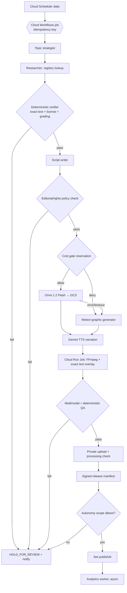

# Architecture Decision Records — Phase 0 (proposed, awaiting founder approval)

Each ADR: context → decision → alternatives rejected → consequences. Status of all: **PROPOSED**.

## ADR-001 Production runs on Google Cloud; Claude Code is dev-only
- **Decision:** Gemini + ADK on Cloud Run/Jobs, Workflows, Scheduler, Firestore, GCS, Secret Manager. Claude Code never in the runtime path.
- **Rejected:** running agents from a laptop/Claude session (no durability, not Google-native).

## ADR-002 Video model: Omni 1.2 Flash primary, motion-graphics fallback, Veo 3.1 Lite optional
- **Context:** Omni 1.2 Flash is GA, 3–15 s, 9:16, `global` only, Interactions API (v1beta1 path). Veo clips max 8 s.
- **Decision:** `gemini-omni-1.2-flash` @720p, `delivery: uri` to GCS, behind a `VideoGenerator` port. Deterministic FFmpeg motion-graphic generator is a first-class second adapter (not just an error fallback) so the budget mix (Scenario C) works. Veo 3.1 Lite adapter only if Omni access fails.
- **Rejected:** Flow/Vids automation (no official API; unofficial wrappers violate blueprint non-negotiables); Omni preview models.
- **Consequence:** Interactions API is `v1beta1` — wrap it and pin request/response fixtures; expect C2PA → permanent YouTube AI label.

## ADR-003 Orchestration: Cloud Workflows outside, ADK graph `Workflow` inside
- **Decision:** Cloud Workflows owns the durable daily job (state, retries, waits for long-running video ops, human-review callbacks). Each step calls a Cloud Run endpoint; content-intelligence steps run an ADK 2.x graph `Workflow` with deterministic validation nodes whose failure is a hard branch to `HOLD_FOR_REVIEW`.
- **Rejected:** LLM sub-agent delegation as the gate (current `agent.ts`) — an LLM can skip a "verifier"; deprecated `SequentialAgent`/`LoopAgent`.

## ADR-004 Implementation language — **founder decision required**
- **Context:** Blueprint mandates Python + Pydantic. Repo is ADK **TypeScript** (`@google/adk ^2.4.0`) and the deployed services appear to be TS/Node. ADK 2.x graph workflows exist in both.
- **Recommendation:** **Python** for agents/contracts (blueprint; larger ADK ecosystem and eval tooling; Pydantic contracts), keep `agent.ts` as an archived reference. Choose TypeScript only if the founder wants to keep the already-deployed code path — then Zod replaces Pydantic and all other ADRs stand.

## ADR-005 Single Gemini billing path: Agent Platform with service identity
- **Decision:** Retire the API-key path (`hidaya-one-dev`, `GOOGLE_GENAI_API_KEY`) once the new service is live; use per-service service accounts with `roles/aiplatform.user` only.
- **Rejected:** API keys in production (long-lived secret, second billing surface, second spend cap).

## ADR-006 State: Firestore (jobs, ledger, source index) + GCS (immutable assets)
- Idempotency key = `channel_id + publish_date + slot`; Firestore transaction creates the job; GCS objects versioned + retention lock on release manifests. BigQuery deferred.

## ADR-007 Religious text is never model output
- Canonical Arabic + approved translation come from the versioned source registry and are rendered by the deterministic renderer (FFmpeg/ASS subtitles with a licensed Arabic font). Video prompts forbid text, people-as-prophets and calligraphy. See `docs/source-governance/`.

## ADR-008 YouTube publisher: private-first, explicit fields
- `videos.insert` resumable, scope `youtube.upload` (+ `youtube.readonly` for reconciliation, `yt-analytics.readonly` for analytics). Always send `privacyStatus: "private"`, `containsSyntheticMedia`, `selfDeclaredMadeForKids`, `paidProductPlacementDetails.hasPaidProductPlacement=false`. Publish = later `videos.update` to `public` or `publishAt`, only from an approved release manifest. Before any re-upload, reconcile by searching own uploads for the job's idempotency tag in the description.
- **Why:** since 2026-11-02 omitted privacy defaults to **public** for all API projects.

## ADR-009 Cost control = ledger reservation + spend caps
- In-app atomic reservation per paid call (blueprint §25) is primary; per-service spend caps on `aiplatform`, `generativelanguage`, `run` are secondary.

## ADR-010 Region
- Run services in `asia-south1` (existing, near founder/audience); call Omni at `global` (only region offered). Document cross-region data flow (prompts + generated media only, no personal data).

## Workflow diagram

## ADR-011 VEED Fabric 1.0 as presenter adapter (founder directive, 2026-11-23)
- **Context:** Founder chose VEED for video creation. VEED's API provides image+audio → talking video (Fabric 1.0), lipsync, dubbing, reframe, background removal — **no scene/text-to-video and no subtitles yet** (see `docs/research/veed-api-evaluation.md`).
- **Decision:** Add `PresenterGenerator` port with a VEED Fabric adapter (async submit/poll, GCS signed-URL inputs, immediate copy of expiring outputs to GCS, `X-Veed-Store-IO: 0`). Scenery = motion graphics (default) or Omni (optional). FFmpeg renderer composites presenter + scenery + exact text.
- **Deviation from blueprint:** VEED is a non-Google hosted service; the blueprint's "Google-only hosted services" rule is relaxed for this adapter by founder decision. Data sent: TTS audio + avatar image only.
- **Guardrails:** avatar must be founder (with consent) or an owned non-photoreal character; no prophets/companions/real scholars; no lip-synced Qur'anic recitation; VEED spend tracked by the same ledger reservation (VEED has prepaid credits — top-up amount acts as an external hard cap).
- **Secret handling:** key held as an environment network secret / Secret Manager in production; never in code, logs or chat.
